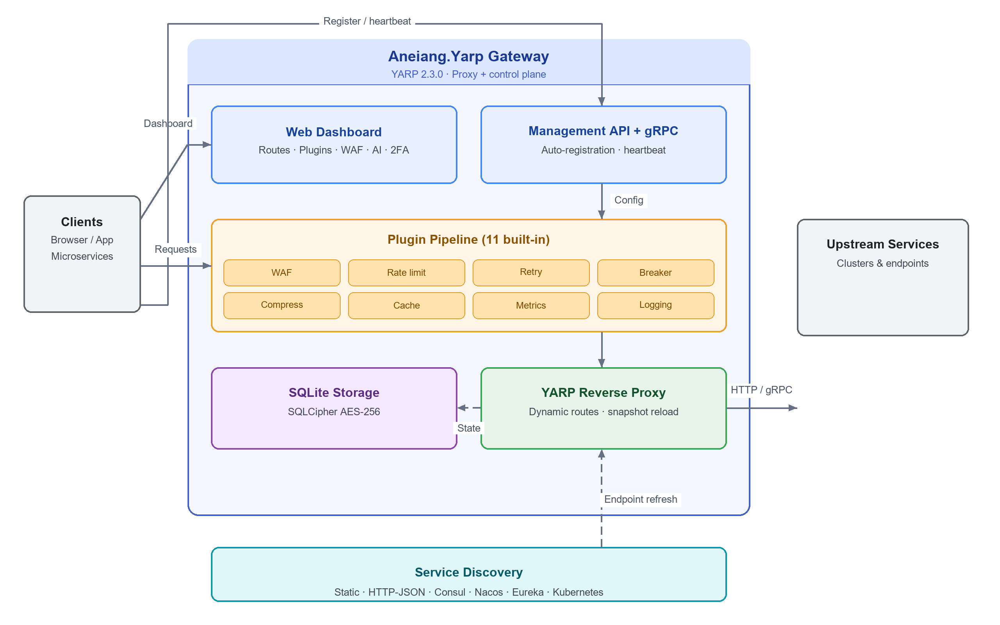

<div align="center">


**Aneiang.Yarp — Full-featured API Gateway powered by YARP**

Plugin Architecture · Dashboard · Dynamic Routing · WAF · Service Discovery · AI Assistant · 2FA · IP Isolation

[](https://www.nuget.org/packages/Aneiang.Yarp)
[](https://www.nuget.org/packages/Aneiang.Yarp.Dashboard)
[](https://www.nuget.org/packages/Aneiang.Yarp.Client)
[](https://github.com/microsoft/reverse-proxy)
[](https://dotnet.microsoft.com/)
[](LICENSE)

[English](README.md) | [中文](README.zh-CN.md)

</div>

---

**Aneiang.Yarp** is a production-ready API gateway built on [Microsoft YARP](https://microsoft.github.io/reverse-proxy/) 2.3.0. It ships with everything you'd otherwise build yourself: a **plugin architecture** (11 built-in plugins), a visual **management dashboard**, WAF, AI assistant, multi-provider **service discovery**, notifications, health & circuit-breaker monitoring, and **one-line client auto-registration**.

[📖 Documentation](https://yarp.aneiang.com/docs/index.html#overview) · [🚀 Live Demo](https://yarp-test.aneiang.com/aneiang) `admin` / `demo123` 

---

## Quick Start

### Minimal

```bash
dotnet add package Aneiang.Yarp
dotnet add package Aneiang.Yarp.Dashboard
dotnet add package Aneiang.Yarp.Storage.Sqlite
```

```csharp
// Program.cs — Gateway
var builder = WebApplication.CreateBuilder(args);
builder.Services.AddAneiangYarp();
builder.Services.AddAneiangStorage();
builder.Services.AddAneiangYarpDashboard();

var app = builder.Build();
app.UseAneiangYarpDashboard();   // includes MapReverseProxy
app.Run();
```

Dashboard: `http://localhost:5000/apigateway`

**Microservice** — auto-registers on startup, no extra code:

```bash
dotnet add package Aneiang.Yarp.Client
```

```csharp
builder.Services.AddAneiangYarpClient();
```

```json
{ "Gateway": { "Registration": { "GatewayUrl": "http://localhost:5000" } } }
```

### Recommended (multi-port + gRPC + hot reload)

```csharp
var builder = WebApplication.CreateBuilder(args);
builder.UseYarpKestrelAutoConfig();           // multi-port / gRPC support
builder.Services.AddAneiangYarp();
builder.Services.AddAneiangStorage();
builder.Services.AddAneiangYarpDashboard();
builder.Services.AddAneiangYarpDeployment();  // deployment modes + health endpoints

var app = builder.Build();
app.UseAneiangYarpDashboard();
app.Run();
```

> Full step-by-step guide: [Quick Start](https://yarp.aneiang.com/docs/index.html#quickstart)

---

## Why Aneiang.Yarp

### Aneiang.Yarp vs. Bare YARP

| Need | Bare YARP | Aneiang.Yarp |
|:-----|:----------|:-------------|
| Management UI | Build your own | ✅ Included |
| Edit config at runtime | Reload file only | ✅ CRUD + form/JSON editor + rollback + audit |
| Security (WAF) | None | ✅ WAF plugin (declarative rules, IP allow/deny, SQLi / XSS / path traversal, monitor mode) |
| Microservice registration | None | ✅ One-line REST/gRPC + heartbeat recovery |
| Observability | Logging only | ✅ Metrics, request logs, health, circuit-breaker panel |
| Service discovery | Manual clusters | ✅ Consul / Nacos / Eureka / K8s / HTTP-JSON / Static |
| AI assistant | None | ✅ Chat-based management (40 tools, read/write split) |
| Extensibility | Custom middleware | ✅ Drop-in `IGatewayPlugin` framework |

---

### Architecture



---

### Highlights

- **Plugin architecture** — everything is a plugin; 10 first-party plugins provide WAF, rate limiting, retry, circuit breaking, compression, caching, metrics and more. Bring your own `IGatewayPlugin` in minutes; the **Plugin Market page** shows what is installed and where it came from, and installs, upgrades or removes external plugins from a local directory.
- **Visual dashboard** — clusters, routes, plugins, WAF, health, circuit breakers, logs, notifications, audit trail and config history in one place.
- **Runtime dynamic routing** — create / edit clusters & routes without restarting; auto-persists and auto-recovers on restart.
- **Native YARP config editing** — dual-mode **form + JSON** editor that works directly on the standard YARP schema.
- **Multi-provider service discovery** — Consul, Nacos, Eureka, Kubernetes, HTTP-JSON, Static.
- **One-line client registration** — microservices register on startup and unregister on shutdown over REST or gRPC, with heartbeat self-healing.
- **AI assistant** — manage the gateway by chat; 40 Function-Calling tools with a strict read/write permission split.
- **Flexible deployment** — `Auto` / `AllInOne` / `Split` / `ProxyOnly` / `DashboardOnly` with role-based endpoints.

---

## Feature Overview

| Area | What you get | Detail |
|:-----|:-------------|:-------|
| **Routing** | Dynamic clusters & routes, drag-sort priority, dual form/JSON editor, import/export, snapshot & rollback, audit log | [:link:](https://yarp.aneiang.com/docs/index.html#dynamic-routing) |
| **Authentication** | `None` / `DefaultJwt` / `CustomJwt` / `ApiKey` / custom delegate; TOTP **2FA**; **RBAC with three roles** (viewer / operator / admin, per-account) | [:link:](https://yarp.aneiang.com/docs/index.html#authentication) |
| **Security** | WAF: declarative rules (conditions x actions incl. `rate-limit`), IP allow/deny, SQLi / XSS / path-traversal detection, monitor mode | [:link:](https://yarp.aneiang.com/docs/index.html#waf-firewall) |
| **Observability** | Request logs (TraceID pairing, sanitization, sampling), real-time WebSocket stream, OpenTelemetry tracing (waterfall + export to Jaeger/Tempo) | [:link:](https://yarp.aneiang.com/docs/index.html#request-logs) |
| **Monitoring** | Request / latency / status metrics (P50/P90/P99), health checks, circuit-breaker panel | [:link:](https://yarp.aneiang.com/docs/index.html#health-check) |
| **Notification** | Webhook channels (DingTalk / HTTP), event rules with cooldown, delivery history | [:link:](https://yarp.aneiang.com/docs/index.html#notifications) |
| **AI Assistant** | Chat-based management, 40 tools, read/write permission split, streaming, multi-provider | [:link:](https://yarp.aneiang.com/docs/index.html#ai-assistant) |
| **IP Isolation** | Route requests to a specific developer's instance by client IP for collaborative debugging | [:link:](https://yarp.aneiang.com/docs/index.html#ip-isolation) |
| **Client SDK** | Auto-register / unregister, heartbeat recovery, `GetServicesAsync` / `UpdateDestinationsAsync` | [:link:](https://yarp.aneiang.com/docs/index.html#client-registration) |
| **Extensibility** | `IGatewayPlugin` contract, plugin-center management, hot-reconfigured bindings | [:link:](https://yarp.aneiang.com/docs/index.html#plugin-system) |
| **Chaos drills** | Per-route delay / error / connection-abort injection, header gate + ratio, off by toggling a binding | [:link:](https://yarp.aneiang.com/docs/index.html#plugin-system) |
| **Multi-environment** | dev / staging / prod isolation, one store file each; switching only moves the editing view, never forwarding; field-level diff + two-step promotion | [:link:](https://yarp.aneiang.com/docs/index.html#plugin-system) |
| **Config safety** | Auto-snapshot, rollback, `GET /api/config/apply-errors`, SQLCipher-encrypted store | [:link:](https://yarp.aneiang.com/docs/index.html#config-history) |

---

## Core Capabilities

### Service Discovery

`ServiceDiscoveryRefreshService` periodically resolves a cluster's destinations from a registry and publishes a new YARP snapshot — no restart. Bound per cluster (`service-discovery` plugin binding).

| Mode | Notes |
|:-----|:------|
| `Static` | Fixed endpoint list |
| `HttpJson` | Generic HTTP endpoint returning JSON endpoints |
| `Consul` | Healthy-instance filtering |
| `Nacos` | `healthyOnly` filter + `hosts` resolution |
| `Eureka` | JSON + `port.$` parsing + `UP` filtering |
| `Kubernetes` | ServiceAccount token + endpoints subsets |

Config: `Mode` (default `Static`), `Endpoint`, `ServiceName`, `Namespace` (`default`), `Scheme` (`http`), `RefreshSeconds` (`30`), `RequestTimeoutSeconds` (`5`).

---

### Observability & Production Readiness

- **Prometheus metrics** — `GET /metrics` exposes the standard text format: `gateway_requests_total`, `gateway_request_duration_seconds` (histogram), `gateway_responses_total{class}`, `gateway_inflight_requests`, `gateway_circuits{state}`, `gateway_config_version`. Collection happens inside the proxy pipeline, so it works whether or not any plugin is bound. Series count is capped at 300; anything beyond collapses into `route="other"` to keep cardinality bounded.
- **Config pre-flight** — `POST /api/config/validate` returns field-addressed errors and warnings before a save; `GET /api/config/integrity` audits the whole configuration (routes pointing at missing clusters, clusters with no destinations, duplicate match paths). **Self-registration, batch import, rollback and the AI assistant all go through the same gate.**
- **Upstream connection pool** — `gateway_upstream_connections{host,state}` reads the built-in `System.Net.Http` meter through a `MeterListener` and separates active from idle. "The pool is saturated" and "the upstream is slow" look identical from the request side; these two lines tell them apart.
- **TTFR** — `gateway_serving` (0/1) and `gateway_first_success_seconds`: from process start to the first successful proxied request. "Up but not routing" is a failure mode every other panel hides.
- **Policy names are no longer free text** — the authorization / CORS / rate limiter / output cache fields are dropdowns backed by nine built-in `gw-*` policies. A name that was never registered is now rejected at save time instead of throwing when YARP builds the endpoint.
- **Optimistic concurrency** — writes carry `X-Config-Version`; a stale version returns `409`, so two open tabs cannot silently overwrite each other.
- **Test baseline** — `tests/Aneiang.Yarp.UnitTests`, 764 xUnit cases covering JSON tolerance, pre-flight validation, the concurrency contract, weighted load balancing, canary rollout, metrics and alert thresholds, tracing, WAF, RBAC roles, OpenAPI generation, plugin contracts, i18n key parity and endpoint↔UI coverage. `.github/workflows/ci.yml` builds, tests and packs on every push.

```bash
dotnet test tests/Aneiang.Yarp.UnitTests
curl -s http://localhost:5000/metrics | head
```

The Grafana dashboard template ships inside the package at `content/observability/grafana-dashboard.json` (source path: `docs/observability/grafana-dashboard.json`).

---

### Canary Releases

The built-in `Weighted` load balancing policy splits traffic **exactly** by destination weight, not "roughly by weight".

**Enabling it** — set the cluster's `LoadBalancingPolicy` to `Weighted` and put `Weight` in each destination's `Metadata`:

```json
{
  "ClusterId": "checkout",
  "LoadBalancingPolicy": "Weighted",
  "Destinations": {
    "v1": { "Address": "http://10.0.0.11:8080", "Metadata": { "Weight": "90" } },
    "v2": { "Address": "http://10.0.0.12:8080", "Metadata": { "Weight": "10", "Tag": "v2" } }
  }
}
```

- **The ratio holds.** It is smooth weighted round-robin: 90/10 means exactly 90 and 10 out of every 100 requests, interleaved rather than 90 in a row. YARP's `PowerOfTwoChoices` also reads `Weight`, but only as a tie-break between two randomly sampled destinations, so the split drifts — no basis for a release decision.
- **Weight 0 parks a node.** It stays configured and reachable by pin, but receives no traffic. Deploy first, shift traffic later.
- **Pin a caller** with `X-Gateway-Canary: v2` (a `Tag`) or `X-Gateway-Canary: d2` (a destination id). The usual order is "pin myself, verify, then move the weights off zero".
- **Per-destination metrics** — `gateway_destination_requests_total{cluster,destination}` and `gateway_destination_failures_total{cluster,destination}`; the Grafana template gains "Canary split by destination" and "Canary error rate by destination".
- **Checked before save** — a non-integer weight, every weight set to 0, or a `Tag` on a cluster not using `Weighted` all produce a field-addressed warning.

Cluster metadata overrides: `Weighted.WeightKey`, `Weighted.DefaultWeight`, `Weighted.TagKey`, `Weighted.HeaderName`.

#### Automatic ramp and rollback

Weights decide the split; something still has to watch the result. That is the rollout state machine — reachable from the canary button on each row of the Dashboard's Clusters page, or directly via `POST /api/canary/rollouts`:

```json
{
  "clusterId": "checkout",
  "canaryDestinations": ["v2"],
  "steps": [10, 30, 50, 100],
  "observationWindowSeconds": 120,
  "errorRateThreshold": 0.2,
  "minSamples": 50
}
```

It moves the weights, opens an observation window, decides when the window closes, then advances or backs out. A rollout only ever ends in `Completed`, `RolledBack`, `Paused` (a human should look) or `Aborted`.

The parts that are deliberate:

- **Verdict order is samples → absolute threshold → attribution.** Too few samples means `Hold` plus a window extension (up to 3), never a rollback on 3 requests out of 3 — an automatic rollback that fires like that is just flapping. Once the threshold is crossed, attribution decides the outcome: canary over threshold *and* baseline over threshold gives `Pause` (`baselineDegraded`), not a rollback. Rolling back fixes nothing there and destroys the evidence. Only "baseline healthy, canary failing" is `RolledBack` (`canaryDegraded`).
- **Rollback restores exactly.** `BaselineExplicitWeights` records which destinations had a `Weight` key at all; a destination that never had one gets the key **removed** on rollback instead of being pinned to `1`. The cluster's `LoadBalancingPolicy` is restored too.
- **Silent no-ops are diagnosed.** A canary that receives zero requests yields `NoCanaryTraffic`, naming `Weighted`, instead of reporting healthy and ramping to 100%.
- **In-process semantics.** Metrics are per-process, so "one cluster behind three gateways" is three independent rollouts. Multi-instance coordination belongs to the single-control-plane design in ADR-1.
- State is persisted to `canary-rollouts.json` next to the SQLite file. A rollout left in `Observing` across a restart becomes `Paused`, because its window baseline is gone and half a window is not a measurement.

Defaults can be overridden in `appsettings.json`:

```json
{
  "Aneiang": {
    "Yarp": {
      "Dashboard": {
        "Canary": {
          "ObservationWindowSeconds": 120,
          "ErrorRateThreshold": 0.2,
          "MinSamples": 50,
          "DefaultSteps": [10, 30, 50, 100],
          "MaxWindowExtensions": 3
        }
      }
    }
  }
}
```

**Plugin extension point** — `PluginCapability` gains `LoadBalancingPolicy` and `Transform`. A third-party plugin implements `IGatewayPluginHostServices.ConfigureHostServices(IServiceCollection)` to register its own policy. Note this receives the *host* container; policies registered from the plugin's runtime container are invisible to YARP.

#### Metric Alerts

A canary rolls itself back, but only while someone is watching. For the hours nobody is watching, thresholds on 5xx rate, p99 latency and open circuit breakers do the shouting. Configure it under **Notifications → Metric Alerts**, or call `POST /api/alerts/rules`:

```json
{
  "name": "checkout 5xx",
  "kind": "ErrorRate",
  "scopeKind": "Cluster",
  "scope": "checkout",
  "threshold": 0.05,
  "windowSeconds": 60,
  "forSeconds": 120,
  "minSamples": 50,
  "severity": "Critical",
  "renotifyMinutes": 30,
  "notifyOnResolve": true
}
```

Three metrics: `ErrorRate` (share of 5xx in the window, `0.05` = 5%), `LatencyP99` (p99 proxy latency in seconds) and `CircuitOpen` (number of open breakers in scope). Scopes are `Global`, `Cluster` or `Route` — circuit rules are cluster-only, because breakers are tracked per cluster.

Deliberate choices:

- **The decision order is window → samples → threshold → duration.** Skip a step and the feature becomes a noise generator. One failed request is a 100% error rate, so below `minSamples` nothing is judged at all; an unfilled window never dresses 15 seconds of traffic up as a 60-second rate; a breach that has not lasted `forSeconds` stays `Pending` and notifies nobody.
- **No data is not recovery.** With no traffic in the window the signal is `InsufficientData`, and a firing incident holds in place. Otherwise "upstream died, so the error counter stopped too" reads as 0% errors — the exact moment a false all-clear is worst.
- **Windows slide.** Each tick keeps a counter snapshot and differences against the newest one at least a window old, so every tick can decide instead of a tumbling window averaging a burst across a boundary. `ObservedSeconds` reports the real coverage: 74s is labelled 74s, not rounded down to the configured 60.
- **`Critical` is delivered as `Error`.** The channels recognise `Error` and `Warning`; anything else falls through to the green checkmark.
- **Delivery state is on screen.** When no platform subscribes to the `MetricAlert` event the panel says so up front, because a rule that evaluates correctly and reaches nobody is this feature's most likely way to die quietly.
- **Recovery is a notification too**, with duration and peak — but only for incidents that actually fired. A breach that recovered while still `Pending` is closed silently: nobody was told it started, so nobody should be told it ended.
- Rules and history persist to `metric-alerts.json` beside the SQLite database. Incidents still open after a restart are closed and marked `gatewayRestarted`: their counter baseline is gone, so they cannot be continued honestly.

Endpoints: `GET /api/alerts`, `POST /api/alerts/rules`, `DELETE /api/alerts/rules/{id}`, `POST /api/alerts/rules/{id}/test` (prove the channel actually delivers) and `POST /api/alerts/incidents/{id}/mute` (silences notifications, not measurement). Every number an alert quotes is visible in `/metrics`: `gateway_route_failures_total{route,cluster}`, `gateway_request_duration_seconds`, `gateway_circuits{state}`.

Defaults are overridable under `Aneiang:Yarp:Dashboard:Alerting` (`TickSeconds`, `MaxIncidents`, `DefaultWindowSeconds`, `DefaultForSeconds`, `DefaultMinSamples`, `DefaultErrorRateThreshold`, `DefaultLatencyP99Seconds`).

---

### Distributed Tracing

Metrics tell you how much is failing. They cannot tell you which hop failed. With tracing on, every stage of a request through the gateway gets its own span — see them on the dashboard's **Tracing** page (or `GET /api/tracing`):

```
GET /api/baidu/{**catchAll}          0.0ms  ───────────────────────────────  26.1ms   Microsoft.AspNetCore
  proxy.forwarder                    0.3ms  ──────────────────────────────   25.8ms   Yarp.ReverseProxy
    gateway.forward                  0.3ms  ─────────────────────────────   25.7ms   route=baidu_api_route
      gateway.plugin rate-limit      0.3ms  ──────────────────────────────  25.4ms
        gateway.plugin circuit-breaker / request-retry / response-cache / proxy-log / traffic-metrics
          GET (System.Net.Http)      0.8ms  ────────────────────────────    24.2ms
```

`gateway.forward` carries `gateway.route.id`, `gateway.cluster.id`, `gateway.destination.id`, `http.response.status_code` and `gateway.short_circuited`, so "which destination is slow" and "did a plugin short-circuit this" are answers you read rather than reconstruct from logs.

Design decisions worth spelling out:

- **Instrumentation lives in the core library, export lives in the dashboard.** `Aneiang.Yarp` only does `new ActivitySource("Aneiang.Yarp")` using the framework's own `System.Diagnostics.DiagnosticSource` — **no new dependency**. The OTel SDK, instrumentation and OTLP exporter all sit in `Aneiang.Yarp.Dashboard`. A gateway that never enables tracing should not carry an exporter in its dependency graph, and definitely should not spend the night logging "cannot reach collector".
- **Third-party plugins are traced without touching them.** The host wraps `IReverseProxyApplicationBuilder` in `TracedProxyPipelineBuilder`, so the `Use()` a plugin receives silently gains a span named after the plugin id. `ConfigureProxyPipeline` keeps its signature.
- **Only 5xx and forwarder errors are marked `Error`.** A 4xx is not marked: a client error is not a gateway failure, and that is the OTel convention. `gateway.short_circuited=true` means a plugin ended the request — no destination chosen, no forwarder error — which keeps "blocked by a plugin" distinct from "upstream is down".
- **Sampling is deterministic**: the verdict is derived from the trace id, so one trace never gets recorded on the parent and dropped on the child. **An inbound `traceparent` sampled flag wins over the local ratio** — overriding it would splice the trace in half exactly at the gateway. The ratio is adjustable from the panel and applies to the next request.
- **Control-plane requests are not traced.** `/{RoutePrefix}`, `/_content`, `/metrics`, `/health|/ready|/live` and `/favicon.ico` are excluded — otherwise the tracing page's five-second poll fills the buffer with the act of looking at it and pushes real traffic out.
- **It works without a collector.** With `ExportEnabled: false` spans go only to the in-memory buffer and the waterfall still renders. The buffer is bounded on every axis (trace count, spans per trace, tag count and tag length) and **never retains an `Activity`** — that would pin the `HttpContext` and the request body. Spans are flattened to strings the moment they end.
- **A failed start does not block the process.** A malformed endpoint or unreachable collector is recorded and shown on the tracing page while the gateway keeps forwarding — the gateway should not refuse to boot because observability is unavailable.
- **The numbers say what they are.** "Kept / dropped" in the sampling column counts **decisions**, including control-plane requests that get filtered out right after sampling, so it will exceed the number of traces actually captured. "Buffer" on the same line is the answer to "how many traces do I have".

Point `Endpoint` at `4317` (gRPC) or `4318` (http/protobuf); one line of Jaeger to look at them:

```bash
docker run -d --name jaeger -p 16686:16686 -p 4317:4317 jaegertracing/all-in-one:latest
```

```json
{
  "Gateway": {
    "Dashboard": {
      "Tracing": {
        "Enabled": true,
        "ExportEnabled": true,
        "Endpoint": "http://localhost:4317",
        "Protocol": "grpc",
        "ServiceName": "aneiang-gateway",
        "Environment": "production",
        "SamplingRatio": 0.1,
        "RecordPluginSpans": true,
        "RecentTraceCapacity": 100,
        "MaxSpansPerTrace": 64
      }
    }
  }
}
```

> Tracing sits under `Gateway:Dashboard`, next to `RoutePrefix` and `Auth`. It is off by default: no spans are produced and no exporter is registered. Changing `Enabled` needs a restart (the provider is built once at startup); changing the sampling ratio does not.

Endpoints: `GET /api/tracing` (status + most recent traces), `GET /api/tracing/traces/{traceId}` (full span list), `POST /api/tracing/sampling` (`{"ratio":0.1}`), `POST /api/tracing/clear`.

---

### Fault Injection

Everything above — retries, circuit breaking, metrics, alerts, automatic rollback — is only verified when a real failure happens. Failures happen at the worst possible time, and almost always when nobody is watching the dashboard. Fault injection flips it around: **manufacture the failure on purpose, then check whether those components do what you said they would.**

Configure it under Plugin Center → Stability → Fault Injection, bound to a route, validated against a JSON Schema:

```json
{
  "enabled": true,
  "probability": 1.0,
  "delayMinMs": 400,
  "delayMaxMs": 800,
  "errorStatusCode": 503,
  "errorBody": "{\"error\":\"upstream_unavailable\"}",
  "abortConnection": false,
  "requiredHeader": "X-Chaos",
  "requiredHeaderValue": "on",
  "announce": true
}
```

Three kinds of fault, usable alone or stacked: **delay** (random between `delayMinMs` and `delayMaxMs`), **error status code** (400–599 plus a custom body), and **connection abort** (a transport-level failure rather than an upstream 5xx — retries and the circuit breaker treat those two differently, so both are worth drilling).

A few decisions that make this safe enough for a real environment:

- **The pipeline position is deliberate: it sits at the innermost position, right next to the forwarder.** Only there is an injected 5xx **indistinguishable from a genuinely broken upstream** for retries, the circuit breaker, metrics, alerts and canary rollback — retries retry it, the breaker counts it, `gateway_route_failures_total` increments, alerts fire, a canary rolls back because of it. Move it to the outer edge and none of those components ever see the fault: the drill "passes", and **a false sense of confidence is worse than no drill at all**.
- **By default it does nothing.** Every field except `enabled` is off; a binding where you only ticked "enabled" does not change a single request. A drill has to describe what it is injecting — otherwise "I ran it and nothing broke" gets mistaken for "the system is stable".
- **`requiredHeader` is the precondition for drilling in production.** Set it and only requests carrying that header are injected; real users are untouched and you can re-run the same check with one `curl`.
- **`probability` gives you "10% of requests fail".** Proving that an alert fires should not require killing the whole route.
- **`abortConnection` wins over `errorStatusCode`** when both are set — a self-contradictory config does not get guessed at.
- **`announce` (on by default) adds `X-Fault-Injected: 503` to the response.** The worst part of a drill is not being able to tell afterwards whether this outage was injected or real; this header is the dividing line. Turn it off when you need a genuinely bare 5xx, e.g. to check client behaviour.
- **Delays honour `RequestAborted`** — the client gives up, the timer stops, otherwise long delays pile up tasks that can only time out. Capped at two minutes so a slip of the finger cannot hang a route.
- **Logging is a `Warning` on the first injection per route, then `Debug`** — a 100% drill should not drown itself in its own explanations.

**"One-click off" means turning off the binding, not the plugin.** Plugin Center refuses to disable a plugin that still has bindings (`409 Remove plugin bindings first: route:xxx`); that guard exists so a misclick does not throw away the whole drill config. When the drill is over, turn the binding's `enabled` off: the next request stops being injected, the config stays, and you can re-open the same drill whenever you like.

```bash
# Stop injecting immediately (config is kept); the prefix defaults to apigateway
curl -X POST http://localhost:5000/apigateway/api/plugin-bindings/batch-enabled \
  -H "Content-Type: application/json" \
  -d '{"bindingIds":["<binding-id>"],"enabled":false}'
```

The panel's toggle does the same thing.

> One easy trip-up: **injection happens inside the retry layer**, so injecting a 503 into a route with retries configured will actually hit the upstream several times and log several injections. That is correct — retry is supposed to see it. When drilling "can retries recover this?", that is the phenomenon you want; when drilling "will the alert fire?", remember to account for the extra duration.

---

### WAF

The WAF used to be five hard-coded checkers behind a row of switches: SQL injection was all-on or all-off, there was no way to say "only on `/api`", and adding "block requests whose UA is sqlmap" meant changing code.

It is now a **declarative rule pipeline**. A rule is an optional detector, an optional set of conditions, and an action:

```json
{
  "mode": "enforce",
  "rules": [
    { "id": "health", "action": "allow",
      "conditions": [ { "source": "path", "op": "prefix", "value": "/health" } ] },

    { "id": "scanners", "action": "block", "matchMode": "any",
      "conditions": [
        { "source": "userAgent", "op": "regex", "value": "(?i)sqlmap|nikto|nmap" },
        { "source": "bodySize", "op": "greaterThan", "value": "1048576" }
      ] },

    { "id": "sql", "builtin": "sql-injection",
      "conditions": [ { "source": "path", "op": "prefix", "value": "/api/" } ] }
  ]
}
```

#### The three parts

| Part | Values | Meaning |
|:--|:--|:--|
| **Detector** `builtin` | `sql-injection` / `xss` / `path-traversal` | Built-in attack-shape detection |
| **Conditions** `conditions` | see below | Alongside a detector they **scope** it; without one they *are* the rule |
| **Action** `action` | `block` / `allow` / `log` / `tag` / `rate-limit` | `allow` stops evaluation and forwards, `log` only records, `tag` writes `X-Waf-Tag` for the upstream, `rate-limit` throttles a rule that keeps matching |

Conditions are one uniform shape — `source` × `op` — instead of a field per combination:

| `source` | Meaning |
|:--|:--|
| `method` / `path` / `query` | Method, decoded path, decoded query string |
| `body` / `bodySize` / `contentType` | Body text, declared size, content type |
| `header` / `cookie` | Requires `name` |
| `userAgent` / `ip` | User agent and client IP |

`op` supports `equals` / `contains` / `prefix` / `suffix` / `regex` / `cidr` / `greaterThan` / `lessThan`; `matchMode` decides whether conditions combine as `all` (default) or `any`.

#### Editing rules in the dashboard

Hand-writing the JSON above is not how anyone should configure a WAF. In the dashboard a rule is a card whose title reads as a sentence:

```
⛔ Block SQL injection (path prefix /api/)
   Detect  [SQL injection ▾]
   [path ▾] [prefix ▾] [/api/          ] [Aa] [×]
   Then    [block ▾] [403]
   ▸ Identity and name
```

A few deliberate choices:

- **Four things are editable on a fresh rule**: what to detect, where to compare, what to compare against, what to do. `tag` appears only for the tag action, `statusCode` only when blocking, `matchMode` only with two or more conditions, and the header/cookie name only for the sources that need it. Putting `tag` on a blocking rule just invites people to fill a field that gets thrown away
- **Operators follow the source**. `cidr` is not offered on a path condition, `greaterThan` not on a user agent. The value control follows too: a method gets suggestions, a size gets a byte readout, a CIDR block is validated, a regex gets a monospace field
- **`id` and `name` are folded under "Identity and name"** - nobody needs to name a rule before it works
- **Five templates**: SQL injection, XSS, path traversal, IP range, observe-only. Starting from a filled card beats starting from fourteen empty fields
- **Rules can be reordered.** Order matters: an `allow` near the top short-circuits everything below it

#### Rate limiting: a gate, not traffic shaping

The `rate-limit` action does not answer "what is this route's quota?" It answers "someone keeps hitting the same rule — make them wait":

```json
{ "id": "login-attempts", "action": "rate-limit",
  "conditions": [ { "source": "path", "op": "equals", "value": "/login" } ],
  "rateLimit": { "limit": 5, "window": "1m", "partition": "ip" } }
```

Past five attempts the request gets 429 with `Retry-After`. A few deliberate choices:

- **No queue.** Queuing an attacker's request only converts their flood into our latency.
- **Fixed window, not sliding.** A sliding window exists so bursts get through as long as the long-run average holds; a gate exists precisely to stop the burst. Fixed window also makes `Retry-After` exact.
- **Rejected requests do not extend the window**, otherwise the gate degenerates into a permanent ban.
- **Buckets are separate from the `rate-limit` plugin.** A route quota is a contract with a client ("1000/min"); a WAF quota is a judgement about behaviour ("five failed attempts"). A shared key space means blocked requests silently eat the client's legitimate allowance. Only the duration syntax (`30s` / `1m` / `1h`) is shared.
- **Bare numbers are refused.** `300` is not 300 seconds — `TimeSpan.Parse("300")` is 300 *days*. Better to drop the rule with a warning at validation time than to amplify a unit typo into a three-month ban.
- `partition` accepts `ip` (default) / `path` / `ip-path` / `global`.

#### monitor: watch the hits before enforcing

With `"mode": "monitor"` the rules still run and still log, but nothing is blocked:

```
[WRN] WAF [SqlInjectionBlocked] rule=sql-from-report from IP: 10.0.0.9, Path: /api/report, Enforced: False
```

That is the only way to find out which real requests a new rule would reject before it starts rejecting them.

#### What gets inspected

Only bodies that can be read **whole** — truncation is deliberately not attempted:

| Dimension | Default |
|:--|:--|
| Content types | `text/*`, JSON, XML, form-urlencoded, GraphQL (plus `+json` / `+xml` suffixes) |
| Skipped | `multipart/*` and binary types — the envelope is transport metadata, not payload |
| Size ceiling | 64KB (`bodyInspection.maxBytes`, hard ceiling 1MB) |
| Over the ceiling | Body check skipped, request forwarded |
| No `Content-Length` | Skipped (cannot be bounded without buffering all of it) |

An inspected body is rewound, so the rest of the pipeline — including the forwarder — sees the original request untouched.

#### What a block looks like

```json
{ "error": "Forbidden", "message": "Blocked by security policy", "waf": true, "rule": "sql" }
```

The response carries `X-Waf-Rule: sql`, which answers the first question anyone asks about a 403. Status, body and extra headers are configurable under `response`, and a single rule can override the status code:

```json
{ "response": { "statusCode": 429, "contentType": "text/plain", "body": "slow down" } }
```

#### Facts worth knowing

- **IP and size checks are a preamble no rule can bypass.** An `allow` rule exempts content inspection, never an IP ban — otherwise one mistyped condition switches the blocklist off
- **Existing configuration upgrades in place.** `enableSqlInjectionDetection`, `ipWhitelist`, `maxRequestBodySize` and friends are all still there; with `rules` empty the classic three-rule pipeline is synthesised, so behaviour matches the previous version — minus the false positives
- **The three switches and the rule list never both apply.** While rules exist those switches take no part in detection — the dashboard greys them out and says why, and offers "convert to editable rules" to turn them into the same three real rules (preamble order: path traversal → SQL injection → XSS). Same behaviour, now visible and adjustable
- **The form validates more strictly than the server, on purpose.** The server's response to a malformed condition is to drop that one condition and log a warning, so an empty value does not fail the save — it disappears, and a rule scoped to `/admin` quietly starts applying everywhere. Nobody reads that warning, so the form has to refuse first
- **A broken rule does not disable the firewall.** Unknown members are ignored; a bad regex or unknown action drops that one rule with a warning while the rest keep running
- **Detectors match attack shapes, not keywords.** `select a size from the list`, `--help` and multipart `------` boundaries pass; `' OR '1'='1`, `admin'--`, `UNION SELECT`, `; DROP TABLE`, `../../etc/passwd` do not

---

### Multi-Environment

One configuration, one environment. Splitting dev / staging / prod needs **two separate answers to two separate questions**: which environment's configuration the gateway is **serving**, and which one you are **editing**. Most tools collapse those into one switch, and then "let me take a look at staging" quietly moves production traffic.

Here they are kept apart on purpose:

| | What it is | Can it change? |
|:--|:--|:--|
| **Runtime environment** | The configuration actually being forwarded | ❌ Fixed at process start |
| **Editing view** | The configuration every dashboard page reads and writes | ✅ Switchable at any time, affects nothing else |

At startup they are the same. After a switch, every route, cluster and plugin binding on screen belongs to the other environment while **forwarding is untouched**; saving anything writes to that environment's store and the snapshot publish is refused.

```json
{
  "Gateway": {
    "Storage": {
      "Sqlite": { "ConnectionString": "Data Source=gateway-store.db" },
      "Environments": {
        "Runtime": "prod",
        "Names": [ "prod", "staging", "dev" ]
      }
    }
  }
}
```

**The implementation is one database file per environment, not one extra column per table.** Isolation is at the filesystem level — a broken dev store cannot reach production:

| Environment | Store file |
|:--|:--|
| `prod` (runtime) | `gateway-store.db` — **exactly** what is configured |
| `staging` | `gateway-store.staging.db` |
| `dev` | `gateway-store.dev.db` |

Two consequences worth spelling out:

- **The runtime environment reuses the configured connection string verbatim**, so an existing deployment upgrades in place with its config, history and audit log still where they were — **no migration**. Suffixing every environment name blindly would have made an upgrade look like "all my config is gone".
- **No table, no SQL and no repository was changed.** That is also why this feature did not require touching the 358 existing tests.

The switcher lives in the dashboard header: grey with a green `LIVE` badge while editing the runtime environment, amber (and saying which environment is still serving) while editing any other. It is not rendered at all for single-environment deployments, so nothing changes for them.

```bash
# Read: runtime environment, current editing view, available list
curl http://localhost:5000/apigateway/api/environments

# Write: switch the editing view (forwarding is unaffected)
curl -X POST http://localhost:5000/apigateway/api/environments/switch \
  -H "Content-Type: application/json" -d '{"environment":"dev"}'
```

A few facts worth knowing before using it:

- **Switching reloads the working set and refreshes the page**, so unsaved form content is lost — the confirmation dialog says so.
- **Logs, metrics and traces are runtime data.** After switching to an environment that never handled traffic, those pages are empty. That is not a bug: there is no traffic there.
- **Environment names are limited to letters, digits, `_` and `-`**, because the name becomes part of a file name. `../prod` fails at configuration time rather than at the moment the store is opened.

#### Environment diff and one-click promotion

Once dev looks right, promoting it to prod is two questions: **what actually differs**, and **is this the same thing I reviewed**:

```bash
# Read: field-level diff, described from the target's point of view
curl "http://localhost:5000/apigateway/api/environments/diff?source=dev&target=prod"

# Write: step one — diff + problems + a single-use token (5 minutes)
curl -X POST http://localhost:5000/apigateway/api/environments/promote/prepare \
  -H "Content-Type: application/json" -d '{"source":"dev","target":"prod"}'

# Write: step two — apply with the token
curl -X POST http://localhost:5000/apigateway/api/environments/promote/apply \
  -H "Content-Type: application/json" -d '{"token":"…"}'
```

Deliberate choices:

- **The diff is rendered as text per field** (`Destinations: 2 → 5`), not `-{...}+{...}`. Only fields that change what traffic does are compared — editing a description is not a difference.
- **The token binds to a config fingerprint, not to the diff.** The first version hashed the diff and a test proved it misses a whole class of change: an "added" route carries no field-level detail, so editing its content between approval and apply produced an identical diff and the promotion went ahead with unreviewed content.
- **A candidate is validated against its own clusters.** Validating staging's routes against prod's cluster table fails in both directions: it rejects sound promotions and accepts broken ones.
- **The token is consumed on use**, so a refused apply cannot be replayed; if either side changes after approval, apply answers 409 and the review has to happen again.

---

## Access Control & Management API

### Roles and permissions

Three roles, split by **blast radius rather than seniority**:

| Role | Can do | Refused by |
|:--|:--|:--|
| `viewer` | Read every page | **Method**: any non-GET/HEAD/OPTIONS is 403 |
| `operator` | Change the gateway: routes, clusters, plugin bindings, environment switches, promotions | **Path**: only the endpoints that decide *who can change the gateway* |
| `admin` | Everything above, plus installing/removing plugins and changing notification targets | — |

```json
{
  "Gateway": {
    "Dashboard": {
      "Auth": {
        "AuthMode": "CustomJwt",
        "JwtSecret": "at least 32 random bytes",
        "Users": [
          { "Username": "alice", "Password": "…", "Role": "admin" },
          { "Username": "bob",   "Password": "…", "Role": "operator" },
          { "Username": "carol", "Password": "…", "Role": "viewer",
            "TwoFactorSecret": "BASE32SECRET" }
        ]
      }
    }
  }
}
```

Deliberate choices:

- **An empty `Users` falls back to the original single-account behaviour** (treated as admin). Existing `JwtUsername` / `JwtPassword` deployments need no change — an upgrade must not lock anyone out of their own dashboard.
- **A viewer is refused by method, not by a path allow-list.** A path list breaks the moment someone adds a page: a new page is a new write entry point, and nobody remembers to update the table.
- **An operator's path deny-list is allow-by-default.** New operational endpoints work without anyone maintaining a table. The cost is explicit: the control-plane endpoints have to be marked — and the opposite failure (an operator blocked by their own dashboard) happens daily.
- **The role travels in the JWT `role` claim**, so **reducing a role requires a new login** (8-hour tokens). That is the behaviour you want for a privilege reduction: not "he'll pick it up after the next refresh".
- **With auth off, an API key, or a custom delegate, the principal is an implicit admin.** Pretending otherwise when there is no account to attribute to only locks existing deployments out. The dashboard does not show a "read-only" notice in that case — the sentence would be false.
- **403 carries a `reason` code** (`read-only` / `admin-required`) that the UI localizes. You read "this account is read-only and cannot change any configuration", not a bare 403 plus an English sentence.
- **Hiding write affordances is experience, not a security boundary.** The enforcement is in the filter — between page load and click, the token can be replaced with a higher-privileged one.

See [`docs/adr/ADR-004-rbac-three-roles.md`](docs/adr/ADR-004-rbac-three-roles.md) for the decision record.

---

### Management API reference

The dashboard *is* the API, so the reference is generated from the routes that are actually mapped rather than hand-written:

```bash
GET <prefix>/api/openapi.json   # OpenAPI 3.1, for generators / Postman / Apifox
GET <prefix>/api-docs           # the human version: grouped by controller, filterable, expandable
```

Also reachable from the sidebar: **System → API Reference**.

A few notes:

- **Add an endpoint and the document changes with it.** A hand-written spec drifts the first time somebody adds an endpoint, and a spec that lies is worse than no spec — it makes the integrator build to the wrong shape and fail in production. Plugin-contributed controllers (circuit breaker, rate limiting, WAF…) hang off the same prefix and are included too.
- **Bodies are derived from CLR types; where that cannot know better it says "any".** `JsonElement` parameters (native YARP config) carry a pointer to the "Configuration reference" section instead of an invented schema — a precise-looking wrong schema makes people write requests that cannot work.
- **`required` follows MVC's rule**: `[FromBody] Model body` is required, `Model? body` or a default value makes it optional.
- **403 descriptions carry the `reason` code** (`read-only` / `admin-required`), matching the RBAC section.
- **The rendering page has zero dependencies** (no CDN, no Swagger UI). A control plane that cannot explain itself offline fails exactly where it matters most.

---

## Plugin System

### Plugin development

Out-of-tree plugins are separate assemblies — no need to rebuild the gateway to install one:

```bash
dotnet new install Aneiang.Yarp.Templates
dotnet new aneiang-yarp-plugin -n MyPlugin --PluginId my-plugin
dotnet publish -c Release -o out
# Dashboard → Plugin Market → Install plugin, then paste the absolute path of out/
# or copy out/ into the host's plugins/my-plugin/ by hand and restart
```

**The Plugin Market page (`<prefix>/plugin-market`)** is the front door to this workflow, and it answers four things on one screen: what is installed (built-in vs external), how many targets each plugin is bound to, upgrade/uninstall for external ones, and the contract an external plugin has to satisfy. Installing only copies files and registers the manifest — it does **not** restart the gateway and does **not** enable the plugin, so "it is installed" and "it is changing traffic" stay two separate actions. Install/upgrade/uninstall require the admin role; the enable switch requires operator or above.

Four things worth knowing first — every one of them is the difference between working code and code that never runs:

- **Middleware goes in `ConfigureProxyPipeline`, not `ConfigureMiddleware`.** The app-level pipeline is built at startup; plugins are enabled and reloaded afterwards, so they cannot add to it. `ConfigureMiddleware` is currently only honoured for the built-in `waf`.
- **`plugin.json` is generated at build time.** `entryAssembly` / `entryType` / `version` are derived from csproj properties, because getting those wrong only shows up **after somebody else installs the plugin**.
- **The contract assembly is not shipped with the plugin** (`ExcludeAssets="runtime"`). The host always uses its own copy; a second one produces two `IGatewayPlugin` types that do not recognise each other.
- **`LoadBalancingPolicy` / `Transform` contributions must go through `IGatewayPluginHostServices`.** Registering them in `ConfigureServices` is a silent no-op.

Scopes, capabilities, `order` and schema versions for the 11 built-in plugins, plus the runtime validation rules
for `plugin.json`, are in [`docs/plugins/plugin-compatibility.md`](docs/plugins/plugin-compatibility.md).

---

### Built-in Plugins

| ID | Scope | What it does |
|:---|:------|:-------------|
| `waf` | Route | Declarative rules (detector / conditions / action), IP allow/deny, request limits, monitor mode |
| `rate-limit` | Route | FixedWindow / SlidingWindow / TokenBucket / Concurrency |
| `request-retry` | Route | Retry with exponential backoff + jitter, status/exception policy |
| `circuit-breaker` | Cluster | Failure threshold, recovery timeout, half-open probing |
| `compression` | Route | Gzip / Brotli by MIME allowlist + min size |
| `response-cache` | Route | Bounded in-memory cache with TTL & vary key |
| `traffic-metrics` | Route | Per-route requests / errors / latency / bytes |
| `cluster-metrics` | Cluster | Per-cluster requests / errors / latency / destinations |
| `proxy-log` | Route | Full proxy capture (headers / optional body), sampling |
| `service-discovery` | Cluster | Periodic registry-backed endpoint refresh |
| `fault-injection` | Route | Delay / error-code / connection-abort injection for drilling retries, breakers, alerts and rollback |

---

## Deployment

Three ways to take it, differing in "do you own the image":

```bash
# 1. Your own project (recommended): one command, ships a Dockerfile and a README
dotnet new install Aneiang.Yarp.Templates
dotnet new aneiang-yarp -n MyGateway && cd MyGateway && dotnet run

# 2. Kubernetes: the Helm chart. Leave the password empty and install generates one into NOTES
helm install gw deploy/helm/aneiang-yarp --namespace gateway --create-namespace

# 3. The official reference image (runs this repo's SampleGateway; for trials and integration tests)
docker build -f deploy/docker/Dockerfile -t aneiang/yarp-gateway:local .
```

Two things to know first:

- **The config store is a single SQLite file, so one replica is the correct number.** Two replicas are two route tables that do not know about each other; the load balancer alternates dashboard requests between them and "the route I just saved is gone". Scale the data plane with `Deployment:Mode: Split`, not with `replicaCount: 2` — the chart refuses to render that and says why.
- **The store must live outside the container.** It holds every route, snapshot and audit record; both official artifacts handle it (`VOLUME /app/data`, and a PVC annotated with `helm.sh/resource-policy: keep`).

Full details — probes, credentials, security context, verification checklist — in [`deploy/README.md`](deploy/README.md).

---

## What We Deliberately Do Not Build

Stating the boundaries up front prevents the wrong tool being picked for the job. None of these are "not done yet" — they are **intentional non-goals**:

| Non-goal | Why | Use instead |
|:--|:--|:--|
| **API portal / developer self-service console** | It turns this into a second Kong Dev Portal, while the gateway's value is data-plane stability, not doc hosting | A dedicated portal; this repo ships `<prefix>/api-docs` and `api/openapi.json`, which is what integrators need |
| **Built-in IdP / user directory** | Identity is a specialist domain; a home-grown account system only weakens the security boundary | Keycloak, Auth0, Azure AD — the gateway validates and forwards tokens |
| **Log storage and search** | The gateway collects and forwards; storing and querying is Elasticsearch / Loki's job | `proxy-log` plugin output plus an external log platform |
| **Service mesh control plane** | Sidecar and ingress-gateway are different architectures; combining them adds both complexities | Istio / Linkerd |
| **Kubernetes Ingress Controller** | Needs CRDs, a reconcile loop and K8s lifecycle semantics — a product, not a feature | ingress-nginx, Traefik, the official YARP ingress path |
| **Distributed rate limiting (cross-instance counters)** | An external counter (Redis) is a new failure domain; per-instance limiting covers most ingress cases | A Redis limiter ahead of `rate-limit`, or divide the quota by instance count |

---

## Appendix

### Package Structure

| Package | Purpose | YARP |
|:--------|:--------|:---:|
| **Aneiang.Yarp** | Gateway core: dynamic routing, IP isolation, API auth, plugin execution | ✅ |
| **Aneiang.Yarp.Dashboard** | Web admin panel + AI assistant | via core |
| **Aneiang.Yarp.Client** | One-line auto-registration (no YARP dependency) | ❌ |
| **Aneiang.Yarp.Storage.Sqlite** | SQLite storage with SQLCipher AES-256 | via storage |
| **Aneiang.Yarp.Storage.Abstractions** | Storage interfaces & entities | ❌ |
| **Aneiang.Yarp.Grpc** | gRPC registration protocol | ❌ |
| **Aneiang.Yarp.Plugin.Abstractions** | Plugin contract (`IGatewayPlugin`) | ❌ |
| **Aneiang.Yarp.Plugin.\*** | 10 first-party plugins, pulled in individually | via core |

**.NET 8.0 / 9.0 / 10.0**.

---

### Documentation

Full documentation lives at **[yarp.aneiang.com](https://yarp.aneiang.com)**.

- **Getting Started** — [Overview](https://yarp.aneiang.com/docs/index.html#overview) · [Quick Start](https://yarp.aneiang.com/docs/index.html#quickstart)
- **Gateway Core** — [Authentication](https://yarp.aneiang.com/docs/index.html#authentication) · [Dynamic Routing](https://yarp.aneiang.com/docs/index.html#dynamic-routing) · [IP Isolation](https://yarp.aneiang.com/docs/index.html#ip-isolation) · [Configuration Reference](https://yarp.aneiang.com/docs/index.html#configuration)
- **Dashboard** — [Dashboard Overview](https://yarp.aneiang.com/docs/index.html#dashboard-overview) · [Config History](https://yarp.aneiang.com/docs/index.html#config-history)
- **Security** — [WAF Firewall](https://yarp.aneiang.com/docs/index.html#waf-firewall) · [Policy Management](https://yarp.aneiang.com/docs/index.html#policy-management)
- **Monitoring** — [Health Check](https://yarp.aneiang.com/docs/index.html#health-check) · [Circuit Breaker](https://yarp.aneiang.com/docs/index.html#circuit-breaker) · [Rate Limiting](https://yarp.aneiang.com/docs/index.html#rate-limiting) · [Request Logs](https://yarp.aneiang.com/docs/index.html#request-logs) · [Request Retry](https://yarp.aneiang.com/docs/index.html#request-retry) · [Notifications](https://yarp.aneiang.com/docs/index.html#notifications)
- **Plugins & Pipeline** — [Plugin System](https://yarp.aneiang.com/docs/index.html#plugin-system) · [Middleware Pipeline](https://yarp.aneiang.com/docs/index.html#middleware-pipeline)
- **Client SDK** — [Client Registration](https://yarp.aneiang.com/docs/index.html#client-registration)
- **AI Assistant** — [AI Assistant](https://yarp.aneiang.com/docs/index.html#ai-assistant)
- **Advanced** — [Deployment Modes](https://yarp.aneiang.com/docs/index.html#deployment-modes) · [Custom Auth](https://yarp.aneiang.com/docs/index.html#custom-auth) · [Production Config](https://yarp.aneiang.com/docs/index.html#production-config)
- **Storage** — [SQLite Storage](https://yarp.aneiang.com/docs/index.html#storage-sqlite)

---

### Contributing

We welcome contributions!

1. Fork the repo and create a feature branch (`git checkout -b feature/your-feature`).
2. Commit with a clear message describing the change and its purpose.
3. Keep the **API surface stable** — new features should ideally be added as plugins.
4. For new plugins, follow the `IGatewayPlugin` manifest conventions (id, display name, version, scope, capabilities) and provide a JSON Schema.
5. When changing Dashboard strings, update both `zh-CN` and `en-US` language packs.
6. Build the solution with **0 warnings / 0 errors** before submitting a Pull Request.

Report bugs and feature requests via GitHub Issues. All first-party packages are MIT-licensed.

---

### NuGet

| Package | NuGet |
|:--------|:-----:|
| **Aneiang.Yarp** | [](https://www.nuget.org/packages/Aneiang.Yarp) |
| **Aneiang.Yarp.Dashboard** | [](https://www.nuget.org/packages/Aneiang.Yarp.Dashboard) |
| **Aneiang.Yarp.Client** | [](https://www.nuget.org/packages/Aneiang.Yarp.Client) |
| **Aneiang.Yarp.Storage.Abstractions** | [](https://www.nuget.org/packages/Aneiang.Yarp.Storage.Abstractions) |
| **Aneiang.Yarp.Storage.Sqlite** | [](https://www.nuget.org/packages/Aneiang.Yarp.Storage.Sqlite) |
| **Aneiang.Yarp.Grpc** | [](https://www.nuget.org/packages/Aneiang.Yarp.Grpc) |
| **Aneiang.Yarp.Plugin.Abstractions** | [](https://www.nuget.org/packages/Aneiang.Yarp.Plugin.Abstractions) |

**.NET 8.0 / 9.0 / 10.0** · **YARP 2.3.0**

---

### License

[MIT](LICENSE)

---

<div align="center" style="display: flex; justify-content: center; align-items: center; gap: 20px;
            background: #f6f8fa; padding: 20px 30px; border-radius: 12px;
            border: 1px solid #e1e4e8; box-shadow: 0 2px 8px rgba(0,0,0,0.05);">
  
  <div style="text-align: left;">
    <h3 style="margin: 0 0 4px 0; font-size: 22px; font-weight: 600; color: #24292e;">
      递归不爆炸
    </h3>
    <p style="margin: 0; font-size: 16px; color: #586069; max-width: 280px;">
      Scan to follow and get more great content
    </p>
  </div>
</div>

<div align="center">

If this project helps you, [⭐ Star it](https://github.com/aneiang/Aneiang.Yarp) to support development

</div>