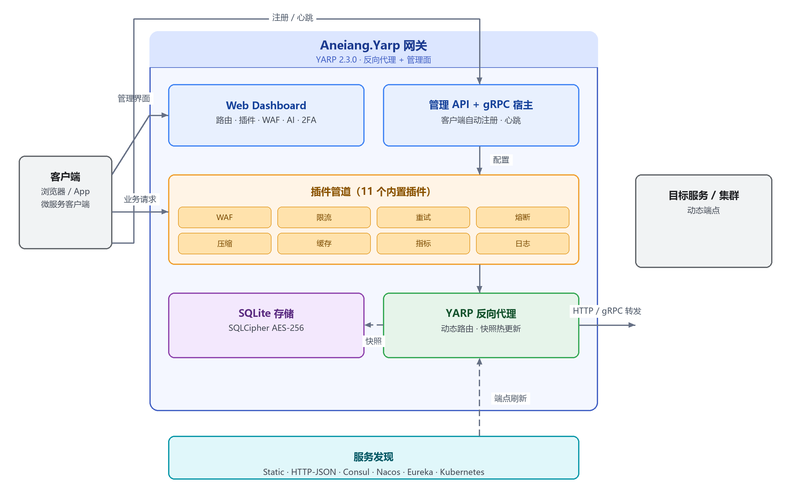

<div align="center">


**Aneiang.Yarp — 基于 YARP 的全功能 API 网关**

插件体系 · Dashboard · 动态路由 · WAF 防火墙 · 服务发现 · AI 助手 · 2FA 验证 · IP 隔离

[](https://www.nuget.org/packages/Aneiang.Yarp)
[](https://www.nuget.org/packages/Aneiang.Yarp.Dashboard)
[](https://www.nuget.org/packages/Aneiang.Yarp.Client)
[](https://github.com/microsoft/reverse-proxy)
[](https://dotnet.microsoft.com/)
[](LICENSE)

[English](README.md) | [中文](README.zh-CN.md)

</div>

---

**Aneiang.Yarp** 是基于 [微软 YARP](https://microsoft.github.io/reverse-proxy/) 2.3.0 构建的生产级 API 网关。它开箱即用地提供了你原本需要自行搭建的全部能力：**插件化架构**（11 个内置插件）、可视化**管理面板**、WAF 防火墙、AI 智能助手、多 Provider **服务发现**、通知告警、健康检查与熔断监控，以及微服务**一行代码自动注册**。

[📖 文档](https://yarp.aneiang.com/docs/index.html#overview) · [🚀 在线演示](https://yarp-test.aneiang.com/aneiang) `admin` / `demo123` 

---

## 快速开始

### 最小可用版

```bash
dotnet add package Aneiang.Yarp
dotnet add package Aneiang.Yarp.Dashboard
dotnet add package Aneiang.Yarp.Storage.Sqlite
```

```csharp
// Program.cs —— 网关
var builder = WebApplication.CreateBuilder(args);
builder.Services.AddAneiangYarp();
builder.Services.AddAneiangStorage();
builder.Services.AddAneiangYarpDashboard();

var app = builder.Build();
app.UseAneiangYarpDashboard();   // 内部已包含 MapReverseProxy
app.Run();
```

Dashboard 地址：`http://localhost:5000/apigateway`

**微服务** —— 启动自动注册，无需额外代码：

```bash
dotnet add package Aneiang.Yarp.Client
```

```csharp
builder.Services.AddAneiangYarpClient();
```

```json
{ "Gateway": { "Registration": { "GatewayUrl": "http://localhost:5000" } } }
```

### 推荐版（多端口 + gRPC + 热更新）

```csharp
var builder = WebApplication.CreateBuilder(args);
builder.UseYarpKestrelAutoConfig();           // 多端口 / gRPC 支持
builder.Services.AddAneiangYarp();
builder.Services.AddAneiangStorage();
builder.Services.AddAneiangYarpDashboard();
builder.Services.AddAneiangYarpDeployment();  // 部署模式 + 健康端点

var app = builder.Build();
app.UseAneiangYarpDashboard();
app.Run();
```

> 详细分步指南：[快速开始](https://yarp.aneiang.com/docs/index.html#quickstart)

---

## 为什么选它

### Aneiang.Yarp 与裸 YARP 对比

| 需求 | 裸 YARP | Aneiang.Yarp |
|:-----|:----------|:-------------|
| 管理界面 | 自行搭建 | ✅ 内置 |
| 运行时编辑配置 | 仅支持重载文件 | ✅ 增删改查 + 表单/JSON 编辑 + 回滚 + 审计 |
| 安全防护（WAF） | 无 | ✅ WAF 插件（声明式规则、IP 黑白名单、SQLi / XSS / 路径遍历、monitor 预演） |
| 微服务注册 | 无 | ✅ 一行代码 REST/gRPC + 心跳自愈 |
| 可观测性 | 仅日志 | ✅ 指标、请求日志、健康检查、熔断面板 |
| 服务发现 | 手动维护集群 | ✅ Consul / Nacos / Eureka / K8s / HTTP-JSON / Static |
| AI 助手 | 无 | ✅ 对话式管理（40 个工具，读写分离） |
| 扩展性 | 自定义中间件 | ✅ 即插即用的 `IGatewayPlugin` 插件框架 |

---

### 系统架构



---

### 项目亮点

- **插件化架构** —— 一切都是插件；11 个第一方插件提供 WAF、限流、重试、熔断、压缩、缓存、监控等能力。编写自己的 `IGatewayPlugin` 即可在几分钟内扩展网关；**插件市场页**把已装插件、来源（内置 / 外部）与安装/升级/卸载放在一处，外部插件从本机目录装进来。
- **可视化管理面板** —— 在一个界面统一管理集群、路由、插件、WAF、健康检查、熔断器、日志、通知、审计与配置历史。
- **运行时动态路由** —— 无需重启即可创建 / 编辑集群与路由，自动持久化并在重启后自动恢复。
- **原生 YARP 配置编辑** —— 表单 + JSON 双模编辑器，直接面向标准 YARP Schema。
- **多 Provider 服务发现** —— Consul、Nacos、Eureka、Kubernetes、HTTP-JSON、Static。
- **客户端一行注册** —— 微服务启动自动注册、关闭自动注销，支持 REST / gRPC + 心跳自愈。
- **AI 智能助手** —— 以对话方式管理网关；40 个 Function Calling 工具，读写权限严格分离。
- **灵活部署** —— `Auto` / `AllInOne` / `Split` / `ProxyOnly` / `DashboardOnly`，基于角色的端口路由。

---

## 功能总览

| 领域 | 你能获得 | 详情 |
|:-----|:---------|:-----|
| **路由** | 动态集群与路由、拖拽排序优先级、表单/JSON 双编辑器、导入导出、快照回滚、审计 | [:link:](https://yarp.aneiang.com/docs/index.html#dynamic-routing) |
| **认证鉴权** | `None` / `DefaultJwt` / `CustomJwt` / `ApiKey` / 自定义委托；TOTP **2FA**；**RBAC 三角色**（只读 / 运维 / 管理员，逐账号授权） | [:link:](https://yarp.aneiang.com/docs/index.html#authentication) |
| **安全防护** | WAF：声明式规则（条件 × 动作）、IP 黑白名单、SQLi / XSS / 路径遍历检测、monitor 预演模式 | [:link:](https://yarp.aneiang.com/docs/index.html#waf-firewall) |
| **可观测性** | 请求日志（TraceID 配对、脱敏、采样）、WebSocket 实时流、OpenTelemetry 链路追踪（瀑布图 + 导出 Jaeger/Tempo） | [:link:](https://yarp.aneiang.com/docs/index.html#request-logs) |
| **监控告警** | 请求/延迟/状态码指标（P50/P90/P99）、健康检查、熔断面板 | [:link:](https://yarp.aneiang.com/docs/index.html#health-check) |
| **通知** | Webhook 渠道（钉钉 / HTTP）、事件规则 + 冷却、发送历史 | [:link:](https://yarp.aneiang.com/docs/index.html#notifications) |
| **AI 助手** | 对话式管理、40 个工具、读写权限分离、流式输出、多服务商 | [:link:](https://yarp.aneiang.com/docs/index.html#ai-assistant) |
| **IP 隔离** | 按客户端 IP 将请求路由到指定开发者实例，便于协作调试 | [:link:](https://yarp.aneiang.com/docs/index.html#ip-isolation) |
| **客户端 SDK** | 自动注册/注销、心跳自愈、`GetServicesAsync` / `UpdateDestinationsAsync` | [:link:](https://yarp.aneiang.com/docs/index.html#client-registration) |
| **扩展性** | `IGatewayPlugin` 契约、插件中心管理、热重配的配置绑定 | [:link:](https://yarp.aneiang.com/docs/index.html#plugin-system) |
| **混沌演练** | 按路由注入延迟 / 错误码 / 连接中断，请求头门 + 比例控制，关绑定即停 | [:link:](https://yarp.aneiang.com/docs/index.html#plugin-system) |
| **多环境** | dev / staging / prod 配置隔离，每环境独立库文件；切换只切编辑视角，转发不动；字段级差异 + 两步提升审批 | [:link:](https://yarp.aneiang.com/docs/index.html#plugin-system) |
| **配置安全** | 自动快照、回滚、`GET /api/config/apply-errors`、SQLCipher 加密存储 | [:link:](https://yarp.aneiang.com/docs/index.html#config-history) |

---

## 核心能力

### 服务发现

`ServiceDiscoveryRefreshService` 周期从注册中心解析集群目标端点并发布新的 YARP 快照 —— 全程无需重启。按集群绑定（`service-discovery` 插件绑定）。

| 模式 | 说明 |
|:-----|:-----|
| `Static` | 固定端点列表 |
| `HttpJson` | 返回 JSON 端点列表的通用 HTTP 端点 |
| `Consul` | 健康实例过滤 |
| `Nacos` | `healthyOnly` 过滤 + `hosts` 解析 |
| `Eureka` | JSON + `port.$` 解析 + `UP` 过滤 |
| `Kubernetes` | ServiceAccount token + endpoints subsets 解析 |

配置项：`Mode`（默认 `Static`）、`Endpoint`、`ServiceName`、`Namespace`（`default`）、`Scheme`（`http`）、`RefreshSeconds`（`30`）、`RequestTimeoutSeconds`（`5`）。

---

### 可观测性与生产化

- **Prometheus 指标** —— `GET /metrics` 输出标准文本格式：`gateway_requests_total`、`gateway_request_duration_seconds`（直方图）、`gateway_responses_total{class}`、`gateway_inflight_requests`、`gateway_circuits{state}`、`gateway_config_version`。采集点在代理管道内，不依赖任何插件是否绑定；序列数上限 300，超出并入 `route="other"`，避免基数爆炸。
- **上游连接池** —— `gateway_upstream_connections{host,state}` 用 `MeterListener` 读取 `System.Net.Http` 内置 Meter，区分 active / idle："池打满"和"上游慢"在请求侧长得一样，但从这两条线一眼能分开。
- **TTFR** —— `gateway_serving`（0/1）与 `gateway_first_success_seconds`：从进程启动到第一个成功代理请求。"起来了但一条都没转发"是其他所有指标都看不出的故障态。
- **配置预检** —— `POST /api/config/validate` 在保存前给出带字段定位的错误/提醒；`GET /api/config/integrity` 对全量配置体检（指向不存在集群的路由、无目标节点的集群、重复匹配路径）。**自注册、批量导入、历史回滚、AI 写操作走同一道闸**。
- **策略名不再是盲填** —— 授权 / CORS / 限流 / 输出缓存四个字段改为下拉，内置 9 个 `gw-*` 策略开箱可用；未注册的名字在保存时即被拒绝，而不是等到构建端点时抛异常。
- **乐观并发** —— 写操作携带 `X-Config-Version`，版本不一致返回 `409`，避免两个标签页互相覆盖。
- **单元测试基线** —— `tests/Aneiang.Yarp.UnitTests`，764 个 xUnit 用例覆盖 JSON 容错、配置预检、并发契约、加权负载均衡、灰度发布、指标与告警阈值、链路追踪、WAF、RBAC 角色、OpenAPI 生成、插件契约、i18n 键一致性与端点↔界面覆盖；`.github/workflows/ci.yml` 每次推送跑编译 + 测试 + 打包检查。

```bash
dotnet test tests/Aneiang.Yarp.UnitTests
curl -s http://localhost:5000/metrics | head
```

Grafana 面板模板随包提供，位于包内 `content/observability/grafana-dashboard.json`（源码仓库路径 `docs/observability/grafana-dashboard.json`）。

---

### 灰度发布

内置 `Weighted` 负载均衡策略，按节点权重**精确**分流，而不是"大致按比例"。

**开启方式**：把集群的 `LoadBalancingPolicy` 设为 `Weighted`，然后在目标节点的 `Metadata` 里写 `Weight`：

```json
{
  "ClusterId": "checkout",
  "LoadBalancingPolicy": "Weighted",
  "Destinations": {
    "v1": { "Address": "http://10.0.0.11:8080", "Metadata": { "Weight": "90" } },
    "v2": { "Address": "http://10.0.0.12:8080", "Metadata": { "Weight": "10", "Tag": "v2" } }
  }
}
```

- **比例是精确的**。实现是平滑加权轮询：每 100 次请求，90/10 就是 90 次与 10 次，且交错分布而不是先连发 90 次。YARP 自带的 `PowerOfTwoChoices` 也读 `Weight`，但只在两个随机节点间用它做平局裁决，实际比例会漂移 —— 灰度决策不能建立在"大概"上。
- **权重 0 = 停车位**。节点保留在配置里但不接流量，适合"先部署、后放量"。
- **按人钉住**：请求头 `X-Gateway-Canary: v2`（填 `Tag`）或 `X-Gateway-Canary: v2`（填节点名如 `d2`）会把这次请求强制打到指定节点。典型顺序是"我先钉住自己验证一遍，再把权重从 0 调到 10"。
- **按目标观测**：`gateway_destination_requests_total{cluster,destination}` 与 `gateway_destination_failures_total{cluster,destination}` 让灰度期间的流量占比和错误率可以逐节点对比；Grafana 模板里对应「Canary split by destination」与「Canary error rate by destination」两块面板。
- **保存前会被检查**：权重不是整数、全部为 0、或者写了 `Tag` 却没启用 `Weighted`，预检都会给出带字段定位的提示。

可覆盖的集群级 metadata：`Weighted.WeightKey`、`Weighted.DefaultWeight`、`Weighted.TagKey`、`Weighted.HeaderName`。

#### 自动放量与自动回滚

权重会算了，接下来要有人盯着看 —— 这件事交给灰度状态机，在 Dashboard「集群」页每行的灰度按钮里操作，或者直接调 `POST /api/canary/rollouts`：

```json
{
  "clusterId": "checkout",
  "canaryDestinations": ["v2"],
  "steps": [10, 30, 50, 100],
  "observationWindowSeconds": 120,
  "errorRateThreshold": 0.2,
  "minSamples": 50
}
```

它会自动改权重 → 开观察窗口 → 关窗口时判定 → 推进下一档或退回去。状态只有四种去处：`Completed`（跑完 100%）、`RolledBack`（灰度自己的错）、`Paused`（需要人看一眼）、`Aborted`（人手动停）。

几个刻意这么设计的地方：

- **判定顺序是「样本量 → 绝对阈值 → 归因」**。样本不够只 `Hold` 并延长窗口（最多 3 次），不会在 3 个请求 3 个失败时就回滚 —— 那样的自动回滚等于抖动。阈值达标后又分两种：灰度错误率超阈值、**基线也在超** → `Pause`（`baselineDegraded`），不回滚。回滚既救不了火，还会把现场销毁掉。只有基线健康、唯独灰度坏，才是 `RolledBack`（`canaryDegraded`）。
- **回滚是精确还原，不是写默认值**。开始时会记下 `BaselineExplicitWeights`，回滚时对原本就没有 `Weight` 键的节点**删掉这个键**，而不是写死成 1；集群的 `LoadBalancingPolicy` 也一并还原。
- **权重没生效会被单独诊断**。灰度侧一个请求都没收到时给 `NoCanaryTraffic` 并点名 `Weighted`，不会伪装成"健康"然后一路推到 100%。
- **进程内语义**。指标是进程级的，所以"一个集群三台网关"是三次独立 rollout，各自推进各自回滚。多实例协同留给 ADR-1 的单控制面方案。
- 状态落盘在 SQLite 同目录的 `canary-rollouts.json`；重启后残留的 `Observing` 会自动转成 `Paused`，因为窗口基线已经失效了，不能拿半个窗口继续判。

默认值可在 `appsettings.json` 覆盖：

```json
{
  "Aneiang": {
    "Yarp": {
      "Dashboard": {
        "Canary": {
          "ObservationWindowSeconds": 120,
          "ErrorRateThreshold": 0.2,
          "MinSamples": 50,
          "DefaultSteps": [10, 30, 50, 100],
          "MaxWindowExtensions": 3
        }
      }
    }
  }
}
```

**插件扩展点**：`PluginCapability` 新增 `LoadBalancingPolicy` 与 `Transform`，第三方插件实现 `IGatewayPluginHostServices.ConfigureHostServices(IServiceCollection)` 即可注册自己的策略（注意走的是宿主容器，不是插件的运行时容器 —— 后者注册的策略 YARP 看不见）。

#### 指标告警

灰度会自己回滚，但前提是有人在看；没人看的时候，5xx 率、P99、熔断开闸该有人喊一声。位置在 Dashboard「通知管理 → 指标告警」，或直接调 `POST /api/alerts/rules`：

```json
{
  "name": "checkout 5xx",
  "kind": "ErrorRate",
  "scopeKind": "Cluster",
  "scope": "checkout",
  "threshold": 0.05,
  "windowSeconds": 60,
  "forSeconds": 120,
  "minSamples": 50,
  "severity": "Critical",
  "renotifyMinutes": 30,
  "notifyOnResolve": true
}
```

三类指标：`ErrorRate`（窗口内 5xx 占比，`0.05` = 5%）、`LatencyP99`（窗口内 P99 延迟，单位秒）、`CircuitOpen`（范围内的开闸数量）。范围可选 `Global` / `Cluster` / `Route`（熔断器按集群记账，所以它没有路由级）。

几个刻意这么设计的地方：

- **判定顺序是「窗口 → 样本 → 阈值 → 持续」**，少一步都会变成噪声：一个失败请求就是 100% 错误率，所以样本量不足时**根本不判断**；窗口还没填满时也不会拿 15 秒的数据冒充 60 秒的速率；越线但没撑满 `forSeconds` 只是 `Pending`，不通知。
- **无数据不等于恢复**。窗口里没有流量时返回 `InsufficientData`，正在 `Firing` 的告警原地保持 —— 否则"上游全挂了、错误计数也停了"会被读成"错误率 0%，一切正常"，而那正是最不该发这条消息的时刻。
- **窗口是滑动的**。每跳留一份计数器快照，取"至少一个窗口之前的最新快照"做差，因此每一跳都能判断，而不是滚动窗口里一簇流量被平均掉。`ObservedSeconds` 如实上报实际覆盖时长（tick 会越过窗口，面板上写 74s 就不写 60s）。
- **`Critical` 以 `Error` 下发**。推送渠道只认 `Error` / `Warning`，其它字符串会落进"一切正常"的绿色勾。
- **投递状态是可见的**。没有任何平台订阅 `MetricAlert` 事件时，面板顶部直接提示"这些告警只会写进日志"。规则配好了却没人收到，是这类功能最典型的死法。
- **恢复也发一条**，带持续时长与峰值；但只在 `Pending` 阶段就恢复的不发 —— 没人知道它开始过，也就不该有人收到它结束。
- 规则与历史落盘到 SQLite 同目录的 `metric-alerts.json`；重启时残留的 `Firing` 会被关闭并标记 `gatewayRestarted`，因为原来的计数器基线已经不在了，续不上。

相关接口：`GET /api/alerts`（规则 + 告警 + 投递状态）、`POST /api/alerts/rules`、`DELETE /api/alerts/rules/{id}`、`POST /api/alerts/rules/{id}/test`（发一条测试通知，验证渠道确实通）、`POST /api/alerts/incidents/{id}/mute`（静默只关通知，不停测量）。告警引用的数字在 `/metrics` 里都看得见：`gateway_route_failures_total{route,cluster}`、`gateway_request_duration_seconds`、`gateway_circuits{state}`。

默认值可在 `appsettings.json` 覆盖：

```json
{
  "Aneiang": {
    "Yarp": {
      "Dashboard": {
        "Alerting": {
          "TickSeconds": 15,
          "MaxIncidents": 200,
          "DefaultWindowSeconds": 60,
          "DefaultForSeconds": 60,
          "DefaultMinSamples": 20,
          "DefaultErrorRateThreshold": 0.05,
          "DefaultLatencyP99Seconds": 1.0
        }
      }
    }
  }
}
```


---

### 链路追踪

指标能告诉你"错了多少"，回答不了"错在哪一跳"。开了追踪之后，一次请求在网关里的每一段都有自己的 span，位置在 Dashboard「链路追踪」页（或直接 `GET /api/tracing`）：

```
GET /api/baidu/{**catchAll}          0.0ms  ───────────────────────────────  26.1ms   Microsoft.AspNetCore
  proxy.forwarder                    0.3ms  ──────────────────────────────   25.8ms   Yarp.ReverseProxy
    gateway.forward                  0.3ms  ─────────────────────────────   25.7ms   route=baidu_api_route
      gateway.plugin rate-limit      0.3ms  ──────────────────────────────  25.4ms
        gateway.plugin circuit-breaker / request-retry / response-cache / proxy-log / traffic-metrics
          GET (System.Net.Http)      0.8ms  ────────────────────────────    24.2ms
```

`gateway.forward` 上带着 `gateway.route.id` / `gateway.cluster.id` / `gateway.destination.id` / `http.response.status_code` / `gateway.short_circuited`，所以"哪个节点慢"和"是不是被插件拦了"都能直接读出来，不用再翻日志。

几个刻意这么设计的地方：

- **埋点在核心库，导出在 Dashboard**。`Aneiang.Yarp` 只 `new ActivitySource("Aneiang.Yarp")`，用的是框架自带的 `System.Diagnostics.DiagnosticSource`，**不加任何依赖**；OTel SDK、instrumentation、OTLP exporter 全在 `Aneiang.Yarp.Dashboard`。不开追踪的网关不该被动背上 exporter，更不该在半夜刷"连不上 collector"。
- **第三方插件零改动就被追踪**。宿主用 `TracedProxyPipelineBuilder` 包住 `IReverseProxyApplicationBuilder`，插件拿到的 `Use()` 自动套一层以插件 id 命名的 span，`ConfigureProxyPipeline` 的签名没变。
- **只有 5xx 和转发错误才标 `Error`**，4xx 不标（客户端错误不是网关失败，这是 OTel 的约定）。`gateway.short_circuited=true` 表示请求被插件拦下 —— 既没有目标节点也没有转发错误，与"上游挂了"分开。
- **采样是确定性的**：按 traceId 哈希判定，同一条 trace 永远同一结论，不会记了父 span 丢了子 span；**入站 `traceparent` 的 sampled 标记优先于本地比例** —— 覆盖它会把链路正好在网关处劈成两半。采样率可在面板上用滑杆改，下一个请求即生效。
- **控制面请求不追踪**。`/{RoutePrefix}`、`/_content`、`/metrics`、`/health|/ready|/live`、`/favicon.ico` 全部排除 —— 追踪页 5 秒轮询否则会把自己填满，把真实流量挤出去。
- **不装 collector 也能看**。`ExportEnabled: false` 时 span 只进内存缓冲，瀑布图照常渲染。缓冲区三重上限（trace 数 / 每 trace span 数 / 每 span tag 数与长度），且**绝不持有 `Activity` 引用**（那会 pin 住 `HttpContext` 和请求体），span 一结束就拍平成字符串。
- **启动失败不阻断进程**。endpoint 写错或 collector 不可达时只记下错误，网关照常转发，原因显示在追踪页顶部 —— 网关不该因为观测系统不可用而起不来。
- **数字的含义要说清**：页面上采样那一列的「已判定 / 已丢弃」是**判定次数**，含被过滤的控制面请求（采样发生在过滤之前），会大于实际捕获的链路数；"我有多少条链路"看同一行的「内存缓冲」。

导出到 Jaeger（一行拉起一个），`Endpoint` 指到 `4317`（gRPC）或 `4318`（http/protobuf）：

```bash
docker run -d --name jaeger -p 16686:16686 -p 4317:4317 jaegertracing/all-in-one:latest
```

```json
{
  "Gateway": {
    "Dashboard": {
      "Tracing": {
        "Enabled": true,
        "ExportEnabled": true,
        "Endpoint": "http://localhost:4317",
        "Protocol": "grpc",
        "ServiceName": "aneiang-gateway",
        "Environment": "production",
        "SamplingRatio": 0.1,
        "RecordPluginSpans": true,
        "RecentTraceCapacity": 100,
        "MaxSpansPerTrace": 64
      }
    }
  }
}
```

> 追踪配置挂在 `Gateway:Dashboard` 之下，和 `RoutePrefix` / `Auth` 同层。默认 `Enabled: false`：缺省不产生任何 span，也不注册 exporter。`Enabled` 改动需要重启（provider 启动时构建一次），采样率不需要。

相关接口：`GET /api/tracing`（状态 + 最近 N 条 trace）、`GET /api/tracing/traces/{traceId}`（完整 span 列表）、`POST /api/tracing/sampling`（`{"ratio":0.1}`）、`POST /api/tracing/clear`。

---

### 故障注入

前面几块能力（重试、熔断、指标、告警、自动回滚）都是"等真故障发生时才验证"的东西 —— 而故障总是发生在最不方便的时候，也总在你没盯着面板的时候。故障注入把这件事反过来：**主动把故障造出来，然后看那些组件有没有按你说的反应。**

配置在「插件中心 → 稳定性 → 故障注入」，绑定到具体路由，走 JSON Schema 校验：

```json
{
  "enabled": true,
  "probability": 1.0,
  "delayMinMs": 400,
  "delayMaxMs": 800,
  "errorStatusCode": 503,
  "errorBody": "{\"error\":\"upstream_unavailable\"}",
  "abortConnection": false,
  "requiredHeader": "X-Chaos",
  "requiredHeaderValue": "on",
  "announce": true
}
```

三类故障可以单独用，也可以叠在一起：**延迟**（在 `delayMinMs`–`delayMaxMs` 之间随机）、**错误状态码**（400–599 + 自定义响应体）、**连接中断**（模拟传输层故障，而不是让上游回一个 5xx —— 这两种情况熔断和重试的处理并不一样，都该演练）。

几个和"敢在真实环境用"直接相关的设计：

- **位置是刻意的：它排在代理管线最内侧，紧挨 forwarder。** 只有在这个位置，注入的 5xx 对重试、熔断、指标、告警、灰度回滚来说才**与上游真的坏了无法区分** —— 重试会重试它、熔断会记它、`gateway_route_failures_total` 会加一、告警会响、灰度会因此退回去。放到最外层，这些组件根本看不见故障，演练会"全部通过"，而**一份假的信心比不做演练更危险**。
- **默认什么都不做。** 除了 `enabled`，每个字段都关着；只勾了"启用"的绑定不会改变任何请求。演练必须自己写清要注入什么，否则"跑了一遍没报错"很容易被当成"系统很稳"。
- **`requiredHeader` 是"敢在生产演练"的前提。** 配上之后只有带该头的请求才被注入，真实用户完全不受影响，你可以拿一个 `curl` 反复验证同一条路由。
- **`probability` 支持"10% 的请求失败"。** 想证明告警会响不需要把整条路由打死。
- **`abortConnection` 与 `errorStatusCode` 同时配置时以中断为准** —— 自相矛盾的配置不做猜测。
- **`announce`（默认开）会给响应加 `X-Fault-Injected: 503`。** 演练最怕的是事后分不清"这次是注入的还是真出了事"，这个头就是那条分界线。要绝对真实的链路（比如验证客户端在裸 5xx 下的表现）可以关掉。
- **延迟遵守 `RequestAborted`**，客户端放弃就停止计时，否则长延迟会攒下一堆只能等超时的任务；上限 2 分钟，防止手滑把整条路由挂住。
- **日志只在每个路由首次注入时打 `Warning`**，之后降到 `Debug` —— 100% 比例的演练不该让解释演练的日志把自己淹掉。

**"一键关闭"指的是关掉这条绑定，不是关掉这个插件。** 插件中心会拒绝禁用"还有绑定的插件"（`409 Remove plugin bindings first: route:xxx`），这是为了防止误点把整场演练的配置一起丢掉。演练结束时把绑定的 `enabled` 关掉：下一个请求立刻不再注入，配置原样保留，随时可以重开同一场演练。

```bash
# 立刻停止注入（配置保留）；{prefix} 是 Dashboard 的 RoutePrefix，默认 apigateway
curl -X POST http://localhost:5000/apigateway/api/plugin-bindings/batch-enabled \
  -H "Content-Type: application/json" \
  -d '{"bindingIds":["<binding-id>"],"enabled":false}'
```

也可以在面板上一次把这条绑定禁用，效果相同。

> 一个容易踩的点：**注入发生在重试内侧**，所以给配了重试的路由注入 503，实际会按重试策略多打几次，日志里也会看到多次注入记录。这是对的 —— 重试本来就该看见它。反过来说，演练"重试能不能救回来"时这正是你要的现象；演练"告警会不会响"时记得把持续时间算进去。

---

### WAF 防火墙

原来的 WAF 是五个写死的检查器加一排开关：SQL 注入要么全开要么全关，没法说"只对 `/api` 开"；想加一条"拦掉 UA 是 sqlmap 的请求"只能改代码。

现在它是一条**声明式规则管线**。一条规则 = 可选的检测器 + 可选的条件 + 一个动作：

```json
{
  "mode": "enforce",
  "rules": [
    { "id": "health", "action": "allow",
      "conditions": [ { "source": "path", "op": "prefix", "value": "/health" } ] },

    { "id": "scanners", "action": "block", "matchMode": "any",
      "conditions": [
        { "source": "userAgent", "op": "regex", "value": "(?i)sqlmap|nikto|nmap" },
        { "source": "bodySize", "op": "greaterThan", "value": "1048576" }
      ] },

    { "id": "sql", "builtin": "sql-injection",
      "conditions": [ { "source": "path", "op": "prefix", "value": "/api/" } ] }
  ]
}
```

#### 三个部分

| 部分 | 可取值 | 说明 |
|:--|:--|:--|
| **检测器** `builtin` | `sql-injection` / `xss` / `path-traversal` | 内置的攻击形状检测 |
| **条件** `conditions` | 见下表 | 与检测器同时存在时用来**限定范围**；没有检测器时条件本身就是规则 |
| **动作** `action` | `block` / `allow` / `log` / `tag` / `rate-limit` | `allow` 停止后续求值并放行，`log` 只记录，`tag` 写 `X-Waf-Tag` 给上游，`rate-limit` 命中太频繁时限速 |

条件是一个统一形状，`source` × `op` 组合，不用记一堆字段名：

| `source` | 含义 |
|:--|:--|
| `method` / `path` / `query` | 请求方法、路径（已解码）、查询串（已解码） |
| `body` / `bodySize` / `contentType` | 请求体文本、声明大小、内容类型 |
| `header` / `cookie` | 需配 `name` |
| `userAgent` / `ip` | UA 与客户端 IP |

`op` 支持 `equals` / `contains` / `prefix` / `suffix` / `regex` / `cidr` / `greaterThan` / `lessThan`；`matchMode` 决定条件是 `all`（默认）还是 `any`。

#### 在面板里配规则

手写上面那段 JSON 不是配置 WAF 的正常方式。面板里一条规则就是一张卡片，卡片的标题把它读成一句话：

```
⛔ 拦截 SQL 注入（路径 前缀 /api/）
   检测 [SQL 注入 ▾]
   [路径 ▾] [前缀 ▾] [/api/          ] [Aa] [×]
   则 [拦截 ▾] [403]
   ▸ 标识与名称
```

几个刻意的取舍：

- **首屏只有四处可改**：检测什么、在哪里比、比什么、怎么处理。`tag` 只在动作是打标签时出现，`statusCode` 只在拦截时出现，`matchMode` 只在有两个以上条件时出现，`header` / `cookie` 名只在需要它的来源上出现 —— 把 `tag` 摆在一条拦截规则上，只会让人去填一个被丢掉的字段
- **操作符跟着来源走**。`cidr` 不会出现在路径条件上，`greaterThan` 不会出现在 UA 条件上。值控件也跟着变：方法是个带建议的输入框、大小是数字加单位换算、CIDR 会校验格式、正则用等宽字体
- **`id` 和 `name` 折在"标识与名称"里**。规则能跑起来之前，没人需要先给它起名
- **五个模板**：SQL 注入、XSS、路径穿越、IP 网段、仅观察。从一张填好的卡片开始，比从十四个空字段开始可靠
- **规则可以上下移**。顺序有意义 —— 一条 `allow` 放在前面会短路后面所有规则

#### 限流：不是流量整形，是闸门

`rate-limit` 动作回答的不是"这条路由的配额是多少"，而是"有人在反复撞同一条规则，先让他停一会儿"：

```json
{ "id": "login-attempts", "action": "rate-limit",
  "conditions": [ { "source": "path", "op": "equals", "value": "/login" } ],
  "rateLimit": { "limit": 5, "window": "1m", "partition": "ip" } }
```

超过 5 次后返回 429 并带 `Retry-After`。几个刻意的选择：

- **没有队列**。把攻击者的请求排队等待，只会把他们的洪水变成我们的延迟
- **固定窗口，不是滑动窗口**。滑动的目的是"只要长期均值没超就让突发过去"，而闸门存在的意义就是拦住突发；固定窗口还让 `Retry-After` 是精确值
- **被拒绝的请求不延长窗口**，否则闸门会退化成永久封禁
- **配额桶与 `rate-limit` 插件完全隔离**。路由配额是对客户的承诺（"1000/min"），WAF 配额是对行为的判断（"五次失败尝试"）。共用键空间意味着被拦的请求会悄悄吃掉客户的合法额度。共享的只有时间语法（`30s` / `1m` / `1h`）
- **裸数字会被拒绝**。`300` 不是 300 秒，`TimeSpan.Parse("300")` 是 300 **天** —— 与其把单位写错放大成三个月封禁，不如在校验期把它丢掉并记一条 warning
- `partition` 可选 `ip`（默认）/ `path` / `ip-path` / `global`

#### monitor：先看命中，再决定拦

`"mode": "monitor"` 时规则照常运行、日志照常写，但**一条都不拦**：

```
[WRN] WAF [SqlInjectionBlocked] rule=sql-from-report from IP: 10.0.0.9, Path: /api/report, Enforced: False
```

上线一条新规则的正确顺序是先观察它命中了哪些真实请求，再改成 `enforce`。没有这一步，第一次发现误报只能是在用户投诉之后。

#### 请求体检查的边界

只扫能**完整读入**的内容，故意不做截断扫描：

| 维度 | 默认 |
|:--|:--|
| 内容类型 | `text/*`、JSON、XML、表单、GraphQL（含 `+json` / `+xml` 后缀） |
| 明确跳过 | `multipart/*` 与二进制类型 —— 上传信封是传输元数据，不是业务载荷 |
| 大小上限 | 64KB（`bodyInspection.maxBytes`，硬上限 1MB） |
| 超出上限 | 跳过 body 检查，请求照常转发 |
| 无 `Content-Length` | 跳过（无法在不全量缓冲的前提下判断大小） |

读完的 body 会**复位**，后续管线（含转发）拿到的是完整的原始请求体。

#### 拦截长什么样

```json
{ "error": "Forbidden", "message": "Blocked by security policy", "waf": true, "rule": "sql" }
```

响应头带 `X-Waf-Rule: sql`，直接告诉你是哪条规则干的。状态码、响应体、附加响应头都可以在 `response` 里改，单条规则也能覆盖状态码：

```json
{ "response": { "statusCode": 429, "contentType": "text/plain", "body": "slow down" } }
```

#### 几点值得知道的事实

- **IP 与大小校验是前导，任何规则都绕不过去**。`allow` 规则可以豁免内容检测，但不能豁免 IP 封禁 —— 否则一条写错的条件就等于把黑名单关了
- **旧配置零迁移**。`enableSqlInjectionDetection`、`ipWhitelist`、`maxRequestBodySize` 这些字段都还在；`rules` 为空时自动合成原来的三条内置规则，行为与升级前一致（除了不再误报）
- **三个内置开关和规则列表不会同时生效**。规则非空时那三个开关不参与检测 —— 面板里会变灰并写清楚原因，同时提供「转成可编辑规则」把它们变成三条真实规则（顺序与编译器一致：路径穿越 → SQL 注入 → XSS），行为不变，但从此可见可改
- **面板的校验比后端严，这是故意的**。后端对写错的条件是"丢弃那一条并记 warning"，所以一个空值的条件不会让保存失败 —— 它会悄悄消失，而一条本该只作用于 `/admin` 的规则就变成了全站生效。用户看不到 warning，所以面板必须在保存前就拦住
- **配置写错不会关掉整个防火墙**。未知字段被忽略，坏正则 / 未知动作只丢弃那一条规则并记 warning，其余规则继续生效
- **内置检测器匹配的是攻击形状，不是关键词**。`select a size from the list`、`--help`、multipart 的 `------` 边界都不会被拦；`' OR '1'='1`、`admin'--`、`UNION SELECT`、`; DROP TABLE`、`../../etc/passwd` 会被拦

---

### 多环境

一份配置管一个环境。想把 dev / staging / prod 分开，就得有**两个不同的问题**各自的答案：网关**正在转发**哪个环境的配置，以及你**正在编辑**哪个环境。这两件事在大多数工具里被合成一个开关，于是"打开 staging 看一眼"就等于把生产流量切到 staging。

这里的做法是彻底分开：

| | 是什么 | 能不能改 |
|:--|:--|:--|
| **运行环境**（runtime） | 网关实际转发用的那套配置 | ❌ 进程启动时固定，运行期不可改 |
| **编辑视角**（editing） | 面板所有页面读写的那套配置 | ✅ 随时切换，不影响转发 |

打开面板时两者相同。切到别的环境后，页面上的路由、集群、插件绑定全部变成该环境的数据，而**转发一点没动**；此时保存任何配置只会写进那个环境的存储，快照发布被拦下。

```json
{
  "Gateway": {
    "Storage": {
      "Sqlite": { "ConnectionString": "Data Source=gateway-store.db" },
      "Environments": {
        "Runtime": "prod",
        "Names": [ "prod", "staging", "dev" ]
      }
    }
  }
}
```

**实现是"每环境一个库文件"，不是每张表加一列。** 隔离是文件系统级的，dev 库怎么折腾都碰不到 prod：

| 环境 | 库文件 |
|:--|:--|
| `prod`（运行环境） | `gateway-store.db` — 与配置里写的**完全相同** |
| `staging` | `gateway-store.staging.db` |
| `dev` | `gateway-store.dev.db` |

两点值得单独说：

- **运行环境沿用原连接串**，所以已有部署升级时配置、历史、审计日志全在原处，**不需要任何迁移**。如果按环境名一律加后缀，升级完会发现配置"全没了"。
- **不改任何表结构、任何 SQL、任何仓储**。这也是为什么这个特性没有把既有 358 个测试改一遍。

切换在面板顶部：编辑运行环境时控件是灰色 + 绿色 `LIVE` 徽标；编辑别的环境时变琥珀色，并直接写明"仍在转发 prod"。单环境部署时整个控件不显示，行为和升级前一致。

```bash
# 读：运行环境、当前编辑环境、可用列表
curl http://localhost:5000/apigateway/api/environments

# 写：切编辑视角（不影响转发）
curl -X POST http://localhost:5000/apigateway/api/environments/switch \
  -H "Content-Type: application/json" -d '{"environment":"dev"}'
```

几个使用上的事实：

- **切换会重载工作集并刷新页面**，未保存的表单内容会丢 —— 确认框里写了这一点。
- **日志、指标、链路追踪是运行态数据**，切到没跑过流量的环境后这些页面会是空的。这不是 bug：那个环境确实没有流量。
- **环境名只允许字母、数字、`_`、`-`**，因为它要进文件名。`../prod` 这类名字在配置加载时就会报错，而不是等到打开库的时候。

#### 环境间差异与一键提升

切到 dev 改完，要把配置推到 prod，需要先看清**差在哪**，再确认**推的是你看过的那一份**：

```bash
# 读：字段级差异（按目标的角度描述）
curl "http://localhost:5000/apigateway/api/environments/diff?source=dev&target=prod"

# 写：第一步，出差异 + 问题清单 + 单次令牌（5 分钟）
curl -X POST http://localhost:5000/apigateway/api/environments/promote/prepare \
  -H "Content-Type: application/json" -d '{"source":"dev","target":"prod"}'

# 写：第二步，带令牌应用
curl -X POST http://localhost:5000/apigateway/api/environments/promote/apply \
  -H "Content-Type: application/json" -d '{"token":"…"}'
```

几个刻意的选择：

- **差异按字段渲染成文本**（`Destinations: 2 → 5`），不是 `-{...}+{...}`。只比较**会改变流量行为**的字段：改一段描述不算差异
- **令牌绑定的是配置指纹，不是差异**。第一版用差异做指纹，测试直接证明它会漏：一个"新增"的路由在差异里不带字段明细，于是批准之后偷偷改它的内容，差异完全相同，提升照常通过 —— 审的是一份东西，应用的是另一份
- **候选配置用它自己的集群校验**。拿 staging 的路由去对 prod 的集群表校验，方向是随机的：既会拦下合法提升，也会放过非法提升
- **令牌用过即失效**，被拒绝的 apply 不能重放；来源或目标在批准后被任何人改动，apply 会 409 并要求重新走一遍

---

## 权限与管理 API

### 角色与权限

三档角色，切分依据是**能造成多大破坏**，不是资历：

| 角色 | 能做什么 | 拒绝方式 |
|:--|:--|:--|
| `viewer` | 看所有页面 | **按方法**：任何非 GET/HEAD/OPTIONS 一律 403 |
| `operator` | 改网关：路由、集群、插件绑定、环境切换、提升 | **按路径**：仅"决定谁能改网关"的那几个端点 |
| `admin` | 上述之外，还能装卸插件、改通知目标 | — |

```json
{
  "Gateway": {
    "Dashboard": {
      "Auth": {
        "AuthMode": "CustomJwt",
        "JwtSecret": "至少 32 字节的随机串",
        "Users": [
          { "Username": "alice", "Password": "…", "Role": "admin" },
          { "Username": "bob",   "Password": "…", "Role": "operator" },
          { "Username": "carol", "Password": "…", "Role": "viewer",
            "TwoFactorSecret": "BASE32SECRET" }
        ]
      }
    }
  }
}
```

几个刻意的选择：

- **`Users` 为空就退回原来的单账号行为**（按管理员处理）。已有的 `JwtUsername` / `JwtPassword` 配置一个字都不用改 —— 升级不该锁住任何人的面板
- **viewer 按方法拒绝，不按路径白名单**。白名单会随页面增加而失效：新加一个页面就出现一个新的写入口，而没人会记得回去更新那张表
- **operator 的路径黑名单是"默认允许"的**。新增的运维端点自动可用，代价是必须记得给真正的控制面端点打标记 —— 这个代价被显式接受，因为反方向（运维被自己的面板挡住）每天都在发生
- **角色放在 JWT 的 `role` claim 里**，所以**降权需要重新登录**（8 小时 token）。这恰好是收紧权限时想要的语义：不靠"等他下次刷新"
- **认证没开、用 API Key、或用自定义委托时，一律视为隐式管理员**。没有账号可归属时假装有角色，只会锁死存量部署。此时面板不会显示"只读"提示 —— 那句话在那种配置下是假的
- **403 带 `reason` 码**（`read-only` / `admin-required`），前端翻成本地语言。看到的是"当前账号为只读，不能修改任何配置"，不是一个裸 403 加一句英文
- **面板按角色隐藏写操作，但这只是体验，不是安全边界**。真正的拦截在过滤器里 —— 页面加载和点击之间，token 可以被换成权限更高的那个

决策记录见 [`docs/adr/ADR-004-rbac-three-roles.md`](docs/adr/ADR-004-rbac-three-roles.md)。

---

### 管理 API 文档

面板本身就是这个 API，所以文档从**实际映射的路由**生成，不是另写一份契约：

```bash
GET <prefix>/api/openapi.json   # OpenAPI 3.1，给代码生成器 / Postman / Apifox
GET <prefix>/api-docs           # 人看的版本：按控制器分组、可过滤、逐操作展开
```

也可以从面板侧栏「系统管理 → API 文档」进。

几点说明：

- **加一个接口，文档就跟着变**。手写的 spec 在有人加第一个接口的那天就开始漂移，而一份会撒谎的文档比没有文档更糟 —— 它让集成方按图施工，然后在生产上 404。插件自带的控制器（熔断、限流、WAF…）挂在同一个前缀下，同样会被收进来
- **请求体由 CLR 类型推导；推导不出来就写"任意"**。`JsonElement` 参数（原生 YARP 配置）只标注「结构见文档『配置参考』」，不编一个看起来精确的 schema —— 那会让人写出必然失败的请求
- **`required` 按 MVC 的规则算**：`[FromBody] Model body` 必填，`Model? body` 或带默认值才可选
- **403 的说明里带 `reason` 码**（`read-only` / `admin-required`），和 RBAC 一节对应
- **渲染页零依赖**（不引 CDN、不引 Swagger UI）。一个连自己都解释不了的控制面，恰好会在最需要它的时候（离线、内网、出不去外网）什么都解释不了

---

## 插件体系

### 开发插件

外部插件是独立的程序集，装的时候不需要重新编译网关：

```bash
dotnet new install Aneiang.Yarp.Templates
dotnet new aneiang-yarp-plugin -n MyPlugin --PluginId my-plugin
dotnet publish -c Release -o out
# 面板 →「插件市场」→ 安装外部插件，填 out 目录的绝对路径
# 或者手工把 out/ 整个目录拷进宿主的 plugins/my-plugin/，再重启
```

**面板里的「插件市场」（`<prefix>/plugin-market`）** 是这条链路的入口，四件事都在一屏：装了什么（按来源分内置 / 外部）、各自绑了几个目标、外部插件的升级与卸载、以及外部插件必须满足的契约。安装只做复制与登记，**不重启网关、也不自动启用** —— 启用与绑定仍然在「插件配置」里，这样"装上去"和"开始改流量"是两个动作。安装/升级/卸载要求管理员角色，启用开关要求运维及以上。

三件必须先知道的事 —— 都是"不知道就会写出一段永远不执行的代码"的那种：

- **中间件写在 `ConfigureProxyPipeline`**，不是 `ConfigureMiddleware`。应用级管线在启动时就构建好了，插件是之后才启用/重载的，加不进去。`ConfigureMiddleware` 目前只对内置 `waf` 生效
- **`plugin.json` 是构建时生成的**。`entryAssembly` / `entryType` / `version` 从 csproj 属性推导，因为这三个字段写错只会在**别人装上去**的时候才暴露
- **契约程序集不随插件分发**（`ExcludeAssets="runtime"`）。宿主始终用自己的那一份，否则会出现两个互相不认的 `IGatewayPlugin` 类型
- 需要 `LoadBalancingPolicy` / `Transform` 能力时**必须**走 `IGatewayPluginHostServices`，写进 `ConfigureServices` 会静默不生效

内置 11 个插件的作用域、能力、`order`、schema 版本，以及 `plugin.json` 的运行时校验规则，见
[`docs/plugins/plugin-compatibility.md`](docs/plugins/plugin-compatibility.md)。

---

### 内置插件

| ID | 作用域 | 功能 |
|:---|:---|:-----|
| `waf` | Route | 声明式规则（内置检测器 / 条件 / 动作）、IP 黑白名单、请求限制、monitor 预演 |
| `rate-limit` | Route | 固定窗口 / 滑动窗口 / 令牌桶 / 并发 |
| `request-retry` | Route | 指数退避 + 抖动重试，状态码 / 异常策略 |
| `circuit-breaker` | Cluster | 失败阈值、恢复超时、半开探测 |
| `compression` | Route | 按 MIME 白名单 + 最小尺寸的 Gzip / Brotli 压缩 |
| `response-cache` | Route | 有界内存缓存，TTL 与 Vary 键 |
| `traffic-metrics` | Route | 按路由的请求 / 错误 / 延迟 / 字节 |
| `cluster-metrics` | Cluster | 按集群的请求 / 错误 / 延迟 / 目标节点 |
| `proxy-log` | Route | 全量代理捕获（头 / 可选 Body）、采样 |
| `service-discovery` | Cluster | 周期注册中心端点刷新 |
| `fault-injection` | Route | 延迟 / 错误码 / 连接中断注入，用于演练重试、熔断、告警与回滚 |

---

## 部署

三种拿走方式，区别是"你要不要拥有这个镜像"：

```bash
# 1. 你自己的项目（推荐）：一条命令生成，自带 Dockerfile 与 README
dotnet new install Aneiang.Yarp.Templates
dotnet new aneiang-yarp -n MyGateway && cd MyGateway && dotnet run

# 2. Kubernetes：Helm chart。密码留空则安装时随机生成，写在 NOTES 里
helm install gw deploy/helm/aneiang-yarp --namespace gateway --create-namespace

# 3. 官方参考镜像（跑本仓库的 SampleGateway，用于试跑和集成测试）
docker build -f deploy/docker/Dockerfile -t aneiang/yarp-gateway:local .
```

两件必须先知道的事：

- **配置存储是单个 SQLite 文件，所以一个副本才是对的。** 两个副本就是两份互不知道对方的路由表，负载均衡把面板请求轮流发过去，"我刚保存的路由不见了"。要扩数据面用 `Deployment:Mode: Split`，不要 `replicaCount: 2` —— Helm chart 会直接拒绝渲染这种配置并说明原因
- **配置存储必须挂在容器外。** 数据库里装的是全部路由、快照和审计记录；两个官方产物都已经处理（`VOLUME /app/data` 与带 `helm.sh/resource-policy: keep` 的 PVC）

完整说明（探针、凭据、安全上下文、验证清单）见 [`deploy/README.md`](deploy/README.md)。

---

## 我们明确不做的事

写清楚边界，是为了避免选型时误判 —— 下面这些不是"还没做"，而是**有意不做**：

| 不做 | 原因 | 该用什么 |
|:--|:--|:--|
| **API 门户 / 开发者自助控制台** | 会把这套东西变成第二个 Kong Dev Portal，但网关的核心价值在数据面稳定，不在文档托管 | 单独的门户产品；本仓库只提供 `<prefix>/api-docs` 与 `api/openapi.json`，够对接方看 |
| **自带 IdP / 用户目录** | 认证是专业领域，自建账号体系只会让安全边界变得更差 | Keycloak、Authing、Azure AD；网关只做 token 校验与转发 |
| **日志存储与检索引擎** | 网关侧只做采集与转发，存与查是 Elasticsearch / Loki 的活 | `proxy-log` 插件输出 + 外部日志平台 |
| **Service Mesh 控制面** | sidecar 模型与网关的"入口集中治理"是两种架构，混在一起会把两边的复杂度叠加 | Istio / Linkerd |
| **Kubernetes Ingress Controller** | 需要 CRD、调谐循环与 K8s 生命周期语义，是另一个产品而不是一个特性 | ingress-nginx、Traefik、YARP 官方 Ingress 方案 |
| **分布式限流（跨实例共享计数）** | 依赖外部计数器（Redis）会引入新的故障域，单机限流已覆盖绝大多数入口场景 | 在 `rate-limit` 之前挂 Redis 限流中间件，或按实例数做配额除法 |

---

## 附录

### 包结构

| 包 | 用途 | 依赖 YARP |
|:----|:-----|:---:|
| **Aneiang.Yarp** | 网关核心：动态路由、IP 隔离、API 鉴权、插件执行 | ✅ |
| **Aneiang.Yarp.Dashboard** | Web 管理面板 + AI 助手 | 通过核心库 |
| **Aneiang.Yarp.Client** | 一行代码自动注册（无 YARP 依赖） | ❌ |
| **Aneiang.Yarp.Storage.Sqlite** | SQLite 存储（SQLCipher AES-256 加密） | 通过存储层 |
| **Aneiang.Yarp.Storage.Abstractions** | 存储接口与实体 | ❌ |
| **Aneiang.Yarp.Grpc** | gRPC 注册协议 | ❌ |
| **Aneiang.Yarp.Plugin.Abstractions** | 插件契约（`IGatewayPlugin`） | ❌ |
| **Aneiang.Yarp.Plugin.\*** | 11 个第一方插件，按需单独引入 | 通过核心库 |

**.NET 8.0 / 9.0 / 10.0**。

---

### 文档中心

完整文档位于 **[yarp.aneiang.com](https://yarp.aneiang.com)**。

- **快速入门** — [项目概览](https://yarp.aneiang.com/docs/index.html#overview) · [快速开始](https://yarp.aneiang.com/docs/index.html#quickstart)
- **核心网关** — [认证鉴权](https://yarp.aneiang.com/docs/index.html#authentication) · [动态路由](https://yarp.aneiang.com/docs/index.html#dynamic-routing) · [IP 隔离](https://yarp.aneiang.com/docs/index.html#ip-isolation) · [配置参考](https://yarp.aneiang.com/docs/index.html#configuration)
- **Dashboard** — [Dashboard 总览](https://yarp.aneiang.com/docs/index.html#dashboard-overview) · [配置历史](https://yarp.aneiang.com/docs/index.html#config-history)
- **安全防护** — [WAF 防火墙](https://yarp.aneiang.com/docs/index.html#waf-firewall) · [策略管理](https://yarp.aneiang.com/docs/index.html#policy-management)
- **监控告警** — [健康检查](https://yarp.aneiang.com/docs/index.html#health-check) · [熔断器](https://yarp.aneiang.com/docs/index.html#circuit-breaker) · [限流](https://yarp.aneiang.com/docs/index.html#rate-limiting) · [请求日志](https://yarp.aneiang.com/docs/index.html#request-logs) · [请求重试](https://yarp.aneiang.com/docs/index.html#request-retry) · [通知](https://yarp.aneiang.com/docs/index.html#notifications)
- **插件与管道** — [插件系统](https://yarp.aneiang.com/docs/index.html#plugin-system) · [中间件管道](https://yarp.aneiang.com/docs/index.html#middleware-pipeline)
- **客户端 SDK** — [客户端自动注册](https://yarp.aneiang.com/docs/index.html#client-registration)
- **AI 助手** — [AI 智能助手](https://yarp.aneiang.com/docs/index.html#ai-assistant)
- **高级用法** — [部署模式](https://yarp.aneiang.com/docs/index.html#deployment-modes) · [自定义认证](https://yarp.aneiang.com/docs/index.html#custom-auth) · [生产环境配置](https://yarp.aneiang.com/docs/index.html#production-config)
- **存储层** — [SQLite 存储](https://yarp.aneiang.com/docs/index.html#storage-sqlite)

---

### 贡献规范

欢迎任何人参与贡献！

1. Fork 本仓库并创建功能分支（`git checkout -b feature/your-feature`）。
2. 提交时使用清晰的提交信息，说明改动内容与目的。
3. 保持 **API 接口稳定** —— 新功能尽量以插件形式提供。
4. 新增插件请遵循 `IGatewayPlugin` 清单约定（ID、显示名、版本、作用域、能力），并提供 JSON Schema。
5. 修改 Dashboard 文案时，同步更新 `zh-CN` 与 `en-US` 两套语言包。
6. 提交 Pull Request 前请完整编译，确保 **0 警告 / 0 错误**。

请通过 GitHub Issues 反馈 Bug 与功能建议。所有第一方包均采用 MIT 许可。

---

### NuGet

| 包 | NuGet |
|:--------|:-----:|
| **Aneiang.Yarp** | [](https://www.nuget.org/packages/Aneiang.Yarp) |
| **Aneiang.Yarp.Dashboard** | [](https://www.nuget.org/packages/Aneiang.Yarp.Dashboard) |
| **Aneiang.Yarp.Client** | [](https://www.nuget.org/packages/Aneiang.Yarp.Client) |
| **Aneiang.Yarp.Storage.Abstractions** | [](https://www.nuget.org/packages/Aneiang.Yarp.Storage.Abstractions) |
| **Aneiang.Yarp.Storage.Sqlite** | [](https://www.nuget.org/packages/Aneiang.Yarp.Storage.Sqlite) |
| **Aneiang.Yarp.Grpc** | [](https://www.nuget.org/packages/Aneiang.Yarp.Grpc) |
| **Aneiang.Yarp.Plugin.Abstractions** | [](https://www.nuget.org/packages/Aneiang.Yarp.Plugin.Abstractions) |

**.NET 8.0 / 9.0 / 10.0** · **YARP 2.3.0**

---

### 许可证

[MIT](LICENSE)

---

<div align="center" style="display: flex; justify-content: center; align-items: center; gap: 20px;
            background: #f6f8fa; padding: 20px 30px; border-radius: 12px;
            border: 1px solid #e1e4e8; box-shadow: 0 2px 8px rgba(0,0,0,0.05);">
  
  <div style="text-align: left;">
    <h3 style="margin: 0 0 4px 0; font-size: 22px; font-weight: 600; color: #24292e;">
      递归不爆炸
    </h3>
    <p style="margin: 0; font-size: 16px; color: #586069; max-width: 280px;">
      扫码关注，获取更多精彩内容
    </p>
  </div>
</div>

<div align="center">

觉得有用？[⭐ Star 一下](https://github.com/aneiang/Aneiang.Yarp) 支持项目发展

</div>