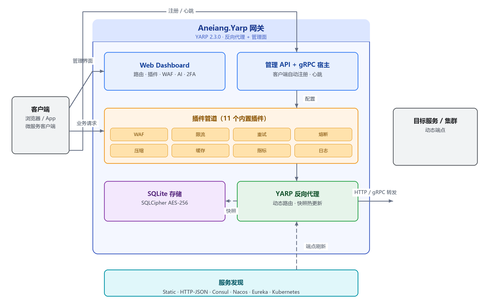
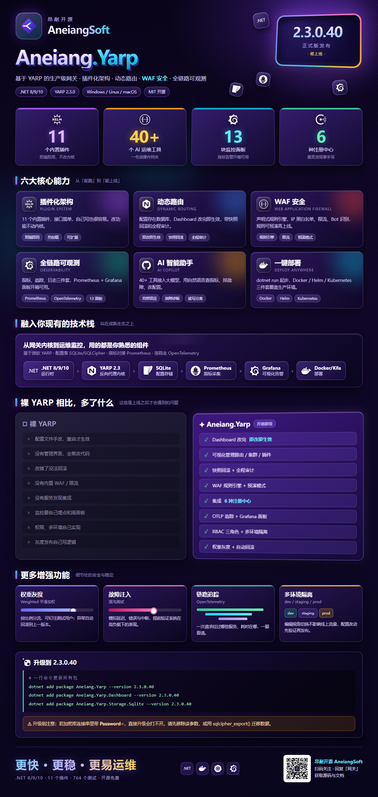

> **发布信息**
> - 主标题：从 2.3.0.30 到 2.3.0.40，这个版本到底加了什么
> - 备选：一次发完四个版本，Aneiang.Yarp 2.3.0.40 都补了哪些东西
> - 摘要：原本四批的功能一次发完。这篇用大白话讲清楚多了什么，以及升级前必须注意的一件事。
> - 封面：`docs/covers/wechat-cover-900x383.png`（2.35:1）/ `wechat-cover-square.png`（1:1）
> - 标签：.NET、YARP、API 网关、版本发布、微服务
> - 配图说明：正文图片用相对路径，发到博客/公众号时需逐张替换为图床或平台上传后的地址

---

# 从 2.3.0.30 到 2.3.0.40，这个版本到底加了什么

**2.3.0.30 解决的是"能不能跑起来"，2.3.0.40 解决的是"敢不敢放到线上、出了问题能不能兜住"。**

## 先看全景

| 能力 | 2.3.0.30 | 2.3.0.40 |
|:--|:--|:--|
| 改配置 | 页面上能改，脚本写入会跳过检查 | 所有入口统一检查，写错就拦 |
| 灰度发布 | 没有 | 想让谁先试就让谁先试，出错自动退 |
| 看运行状态 | 只能翻日志 | 监控大盘 + 链路追踪 + 异常告警 |
| 安全 | 能登录 | 加密、权限、操作记录全补齐 |
| 多环境 | 只有一套配置 | 测试和生产各管各的 |
| WAF 防护 | 规则得手写 JSON | 页面上点一点就能配 |
| 插件 | 外部插件装了也用不了 | 有插件市场，装完就能配 |
| 部署 | 自己写 Dockerfile | 模板 + Dockerfile + Helm |
| 框架支持 | .NET 8 / 9 | .NET 8 / 9 / 10 |



*前面是干活的（转发请求），后面是管理的（改配置、看数据）*

## 安全：从能登录到敢上线

登录令牌只留一个安全位置，退出登录是真退；密码加密存，数据库换真加密的 SQLite，密钥不对直接打不开。谁在什么时候改了什么，都有账可查。


*谁、做了什么、结果如何*

> ⚠️ **升级前必看**：旧库是明文存的，升级后连接串里带 `Password=` 会直接打不开。删掉它，或用 `sqlcipher_export()` 迁移。**别直接升。**

## 灰度：新版本先给一部分人用

按比例分流（比如 10% 走新版本），也能用 `X-Gateway-Canary` 把某个人钉住先试。放量后错误率异常自动回滚；连老版本都挂了就暂停、不回滚——免得把现场毁了。


*权重、健康状态、排序，面板上一眼看清*

## 可观测：线上出问题看得见

加了指标接口、链路追踪和告警。一个请求从进网关到后端，每段花了多久，页面上直接看瀑布图；认证失败和路径写错分开报，不用再猜"连不上"是为什么。


*一层层调用、耗时条、瀑布图*


*请求量、成功率、集群健康*

## 多环境、权限、部署

测试和生产中各用各的数据库，切到测试改东西，生产流量一点不动。配置从测试提到生产分两步：先看差异，再用 5 分钟令牌确认。权限分只读、运维、管理员三级，按"能造成多大破坏"划分。部署给模板、Dockerfile、Helm 三件套。

## WAF 和插件

WAF 规则从手写 JSON 变成页面卡片，一张卡一条规则，还修了两个误拦（文件上传、首个请求）。插件顺序不再写死，外部插件终于能在面板上配置，市场装完自动进"扩展"组。


*一条规则一张卡片*


*内置和外部插件同屏*

## 框架和升级

net8 / net9 / net10 三目标，一份代码出三个包。老的 net8 不能删——删了外部插件全部编译不过。

```bash
dotnet add package Aneiang.Yarp --version 2.3.0.40
dotnet new install Aneiang.Yarp.Templates
```

文档 yarp.aneiang.com/docs，在线 demo：yarp-test.aneiang.com/aneiang（admin / demo123），随便点，改坏了刷新就行。




**昂耐开源 AneiangSoft**｜写 .NET、写网关，也写踩过的坑
