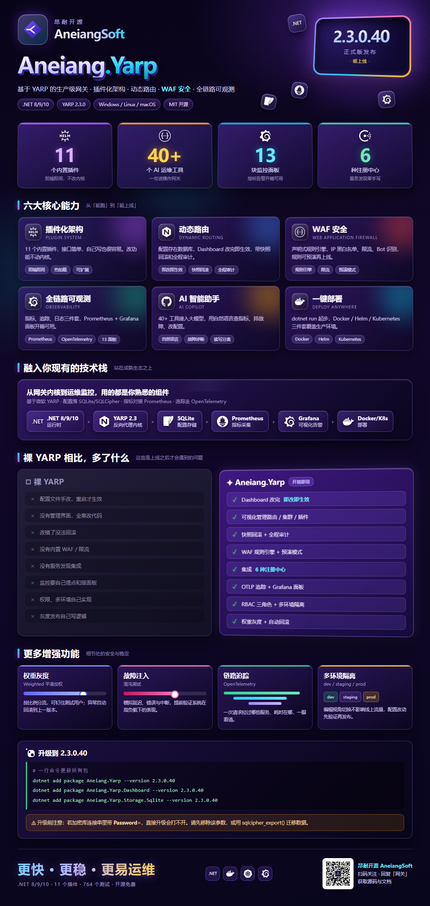

> **发布信息**
> - 标题：憋了四个版本，2.3.0.40 一次性发完了
> - 备选：2.3.0.40 发版，这次改的东西有点多
> - 摘要：Aneiang.Yarp 这个版本改了什么，以及升级前得先看哪一条
> - 封面：`docs/covers/wechat-cover-900x383.png`（2.35:1）或 `wechat-cover-square.png`（1:1）
> - 标签：.NET、YARP、API 网关、版本发布

---

# 憋了四个版本，2.3.0.40 一次性发完了

*Aneiang.Yarp 这个版本改了什么，以及升级前得先看哪一条*

先说版本号，不然容易搞混。2.3.0 是 YARP 的版本，40 是我们这个项目的版本。

2.3.0.30 之后原本排了四批，2.4.0、2.4.1、2.5.0、2.6.0，后来想想没必要分批发，全并进了 2.3.0.40。CHANGELOG 里那些 v2.5、v2.6 只是当时的批次名。

所以这一版东西有点多。

## 升级前先看这条

SQLCipher 这次是动真格的。如果你的旧库是明文写的，升级时连接串里带 `Password=`，会直接打不开。两条路：把 `Password=` 去掉，或者用 `sqlcipher_export()` 迁移。别直接升。

加密到底有没有生效，我们验了三遍。`PRAGMA cipher_version` 有值；拿密文去扫，搜不到哨兵串；用错密钥打开报 `SQLITE_NOTADB`。另外加了启动自检，连接串写了密码但 provider 根本不能加密，构造的时候就抛，不会装作没事。

## 安全这块改了 19 项，挑几个说

会话改成 HttpOnly cookie，响应体和 localStorage 里的 token 全删了。这两个地方同时存，cookie 那层等于白做。

JWT 校验 alg 头，加了 jti 和吊销表，logout 是真的能登出。密钥文件在 Unix 上收紧到 0600，读取时再收紧一次。登录限流用双键滑动窗口，各种比较统一走 FixedTimeEquals。

2FA 加了 lastAcceptedCounter 高水位防重放，setup 从 GET 改成 POST，2fa 开头的接口只给 admin。转发头清空了框架默认信任的 loopback，可信代理支持 CIDR，解析不了的条目单独告警，不把整份配置作废。

出站 Webhook 分三段校验，关闭自动重定向，日志和响应里的 URL 凭据脱敏。认证、授权、插件、2FA 全写审计。


*审计记录：谁在什么时候改了什么*

## 灰度这次是真的能动了

Weighted 用 nginx 那套平滑加权轮询，权重从目标节点的 `Metadata.Weight` 读，写 0 表示注册了但不接流量。全部是 0 就退回第一个可用节点。`X-Gateway-Canary` 能把某个真实用户先钉在新版本上。

自动放量默认 10、30、50、100 四档，每档窗口 120 秒，错误率超 20% 且样本够 50 个才回滚。样本不够就 Hold 并把窗口拉长。基线自己也在挂的时候选 Pause 而不是 Rollback，这时候回滚既救不了火，还把现场毁了。

修了一个挺要命的 bug。以前判断目标有没有变，看的是 `DestinationState` 的引用，而 YARP 重载会保留实例只换 Model，结果权重表在第一次请求后就被冻住了。灰度每一步改的都是权重，这个 bug 会让整个流程看起来在跑、实际一步没动。

## 出问题的时候能不能看见

`/metrics` 走文本格式，采集点放在代理管线里面，不依赖你绑没绑插件。基数上限 300，超出的并进 `route="other"`，顺手计一个 dropped_series，不会把 Prometheus 打爆。

追踪埋点在核心库，只 new 一个 `ActivitySource`，SDK 和 exporter 全在 Dashboard。不开追踪的网关不背这层依赖。第三方插件不用改代码，包进管线就自动有 span。采样按 traceId 哈希，同一条链路结论一致，不会出现记了父 span 丢了子 span 的情况；入站 traceparent 的 sampled 标记优先。

追踪页那个「测试」按钮不是摆设，真发一个空批次。401 和 404 分开报，401 是让你换凭据，404 是让你补路径。以前这些失败一律显示「连不上」，查半天不知道差在哪。

告警支持错误率、P99、熔断三类规则。一个失败请求就是 100%，所以加了 MinSamples，样本不够不判断；没流量的时候也不会回判「已恢复」。Grafana 模板从 11 个面板加到 13 个。


*健康检查面板：上游状态与连续失败次数*

## 多环境：切的是编辑视角，不是流量

每个环境一个 SQLite 文件，prod 用原连接串，其他环境派生后缀。存量部署不用迁移，dev 库弄坏了也不影响 prod。RuntimeEnvironment 启动就定死，决定转发；CurrentEnvironment 只决定面板在读写哪个。切到 dev 改东西，生产流量一点不动，顶部还会明写「仍在转发 prod」。

提升分两步。diff 按字段显示成「Destinations: 2 → 5」，只列会改变流量行为的部分。prepare 返回差异、问题清单和一个 5 分钟令牌，apply 必须带这个令牌，用过就废。令牌指纹哈希的是两侧配置本身，不是渲染后的差异。用差异做指纹的话，批准之后偷改内容，差异一模一样，审的和发的就不是同一份东西了。

RBAC 也补上了，viewer、operator、admin 三个角色。切分依据是谁能造成的破坏大，不是谁的级别高。Users 为空时退回原来的单账号行为，升级不该先把人锁在外面。

## WAF 重写了，规则不再是手写 JSON

现在是声明式规则引擎，10 种来源、8 个操作符、5 种动作。编辑器改成一张卡片一条规则，标题直接读成一句话，首屏只留「检测什么、在哪里比、比什么、怎么处理」。

顺手修了两个误拦。文件上传被 multipart 里的 `------WebKitFormBoundary` 命中了检测正则，100% 返回 403；首个请求因为正则首次编译耗时超过 50ms 预算，被当成命中，偶发 403。现在正则在启动时预热，一次性成本变成启动慢一点，不再误伤请求。


*一条规则一张卡片*

## 部署和框架

net8.0、net9.0、net10.0 三目标，17 个工程每个包出三份 lib 资产。插件契约保留 net8.0 下限，这个不能删，删了外部插件下一次 restore 就是 NU1202。net10 废弃的那几个 API 用条件编译分开实现，没给整个工程加 NoWarn。

部署三件套也齐了：dotnet new 模板、非 root 的 Dockerfile、Helm chart。Helm 会直接拒绝 replicaCount 大于 1，因为配置存储是单个 SQLite 文件，两个副本就是两份互相不知道的路由表。CI 里加了 deployables 作业，模板真编译、chart 真渲染、镜像真构建，不再只是过个编译。


*插件市场：内置和外部插件同屏*

## 怎么升

```bash
dotnet add package Aneiang.Yarp --version 2.3.0.40

dotnet new install Aneiang.Yarp.Templates

# Helm
version: 2.3.0-40
appVersion: "2.3.0.40"
```

再提醒一遍，老库是明文的，先处理 `Password=` 那个问题。

文档在 yarp.aneiang.com/docs，在线 demo 是 yarp-test.aneiang.com/aneiang，admin / demo123，随便点。碰到问题来 issue 里说。



*一张图看完*


**昂耐开源 AneiangSoft**｜写 .NET、写网关，也写踩过的坑

---

*本文基于 2.3.0.40 更新日志（2026-11-20）。*
