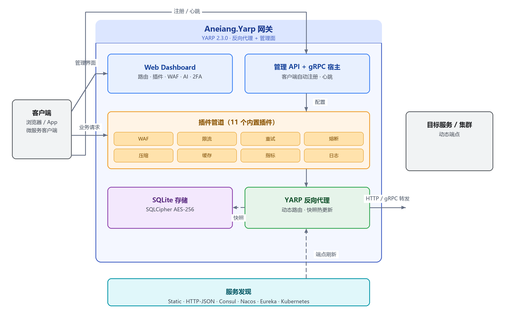
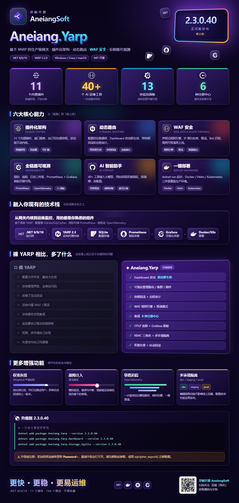

> **发布信息**
> - 标题：YARP 很好用，就是上线之后有点裸
> - 备选：用 YARP 上线半年，我把缺的那些自己补了
> - 摘要：所以我给它补了个控制台，顺手把 WAF、服务发现这些也补了
> - 封面：`docs/covers/wechat-cover-900x383.png`（2.35:1）或 `wechat-cover-square.png`（1:1）
> - 标签：.NET、YARP、API 网关、微服务

---

# YARP 很好用，就是上线之后有点裸

*所以我给它补了个控制台，顺手把 WAF、服务发现这些也补了*

用 YARP 做网关，转发这块几乎不用操心。配置文件写完，二十行代码就能跑起来，性能也好。

问题都出在转发之外。

改一条路由，得改配置文件然后重启。想加限流、熔断，得自己写中间件。线上慢了，只能翻日志猜是哪一跳。服务扩到三个实例，集群配置要手工改三遍。

这些事单拎出来都不难，但每样都要自己写一遍，写完还得自己维护。

YARP 的定位本来就是这样，它是反向代理库，不是网关产品。这个定位我觉得没问题，数据面做到极致就够了，剩下的留给使用者。

只是「剩下的」比想象中多。我把它们补上了，叫 Aneiang.Yarp。

## 差的是这几件事

| 需求 | 裸 YARP | 现在 |
|:--|:--|:--|
| 管理界面 | 自己搭 | 内置面板 |
| 改配置 | 改文件 + 重启 | 在线改，可回滚 |
| WAF | 没有 | 规则引擎 |
| 服务注册 | 没有 | 一行代码 |
| 服务发现 | 手写集群 | 6 种注册中心 |
| 可观测 | 只有日志 | 指标 + 追踪 |
| AI 运维 | 没有 | 40 个工具 |
| 扩展 | 写中间件 | 插件，即插即用 |

*按默认管线和内置中间件比。*

八行里我最在意的是第二行。配置能在线改、改错了能退回去，这件事对运维的价值，比再加十个功能都大。

## 里面是怎么搭的



*点开可放大*

图里四块。数据面是 YARP 加一条插件管道，请求在这里被限流、被拦、被改写。控制面是面板和 REST API，改完写进快照，下一个请求就生效。存储就一个 SQLite 文件，路由、快照、审计都在里面，可以开 SQLCipher 加密。SDK 给业务侧用，不依赖 YARP。

有个设计我个人挺满意：面板的编辑视角和实际转发是分开的。切到 dev 环境改配置，生产流量完全不受影响，保存也只写进 dev 那个库。多环境部署时这条边界省了不少麻烦。

## 先跑起来

```bash
dotnet add package Aneiang.Yarp
dotnet add package Aneiang.Yarp.Dashboard
dotnet add package Aneiang.Yarp.Storage.Sqlite
```

```csharp
var builder = WebApplication.CreateBuilder(args);

builder.Services.AddAneiangYarp();
builder.Services.AddAneiangStorage();
builder.Services.AddAneiangYarpDashboard();

var app = builder.Build();
app.UseAneiangYarpDashboard();
app.Run();
```

打开 `http://localhost:5000/apigateway` 就是面板：


*点开可放大*

到这一步还没写过一行路由配置。集群和路由都在页面里加，保存后就生效，不用重启。

## 四个我平时用得最多的

### 改错了能退回去

路由、集群、插件绑定都能在运行时增删改，表单和 JSON 两个编辑器，JSON 那边直接按 YARP 的标准 Schema 写，不另造一套格式。

每次保存留一份快照，配错了选一份退回去。审计里记着谁在什么时候改了哪个字段，出了事不用靠猜。


*拖排序就是优先级*

### WAF 先只看不拦

规则是声明式的，条件加动作，内置 SQL 注入、XSS、路径遍历检测，也能配 IP 黑白名单。

上线前建议先开 monitor 模式：规则全开，只记录不拦，跑几天看命中记录里有没有正常的业务请求，确认没冤枉人再切拦截。WAF 出事故基本都是误杀，不是漏拦。


*一条规则就是一张卡片*

### 服务自己注册

业务项目装上 `Aneiang.Yarp.Client`，加一行注册、配个网关地址：

```csharp
builder.Services.AddAneiangYarpClient();

// appsettings.json
"Gateway": {
  "Registration": {
    "GatewayUrl": "http://localhost:5000"
  }
}
```

启动注册，关闭注销，中间有心跳。网关先起还是服务先起都行，顺序无所谓。REST 和 gRPC 都支持。

### 用嘴管网关

面板里可以直接说「把 /api/order 的灰度权重调到 20%」。背后是 40 个 Function Calling 工具，覆盖路由、集群、插件、日志和指标。

权限做的是读写分离。只读账号就算把这句话原样贴进去，也只能查，改不动。

说实话我一开始对这块没什么兴趣，觉得是加个聊天框凑热闹。后来用了几次查指标，比自己翻页面确实快。


*它会真的去调工具，不是编一段答案给你*

## 部署时容易踩的两个坑

```bash
dotnet new install Aneiang.Yarp.Templates
dotnet new aneiang-yarp -n MyGateway
cd MyGateway && dotnet run

helm install gw deploy/helm/aneiang-yarp \
  --namespace gateway --create-namespace
```

第一，配置存储是单个 SQLite 文件，所以只能跑一个副本。两个副本就是两份互不知道对方的路由表，负载均衡把面板请求轮流发过去，于是你刚保存的路由「不见了」。要扩数据面用 Split 模式，别调 replicaCount，Helm chart 会直接拒绝渲染这种配置，并写清楚原因。

第二，存储要挂在容器外。里面是全部路由、快照和审计记录，丢了就是丢了。Docker 镜像里已经声明了 `VOLUME /app/data`，Helm 的 PVC 带了 resource-policy: keep。

## 有些事我没做

选型的时候，说不做什么比列功能更有用。下面几条是明确的，不是「以后再说」。

API 门户不做。文档托管会把这东西变成第二个 Kong Dev Portal，网关的核心价值在数据面稳不稳，不在帮你写文档。现在只给对接方留了 api-docs 和 openapi.json，够用。

账号体系不做。认证是专业活，自己造一套只会让安全边界更差，接 Keycloak 或者 Azure AD 就行，网关负责校验 token。

Ingress Controller 不做。CRD、调谐循环、K8s 生命周期，那是另一个产品的复杂度，硬塞进来两边的坑都得踩。

## 最后

项目 MIT 开源，NuGet 上直接装，.NET 8 / 9 / 10 都能用。仓库里还有 Dockerfile、Helm chart 和一个项目模板。

文档：yarp.aneiang.com/docs
在线 demo：yarp-test.aneiang.com/aneiang（admin / demo123，随便点，改坏了刷新就行）

如果你也在用 YARP，碰到什么问题可以来 issue 里说一声。



*一张图看完*


**昂耐开源 AneiangSoft**｜写 .NET、写网关，也写踩过的坑

---

*示例基于 Aneiang.Yarp 2.3.0.40，YARP 2.3.0。*
